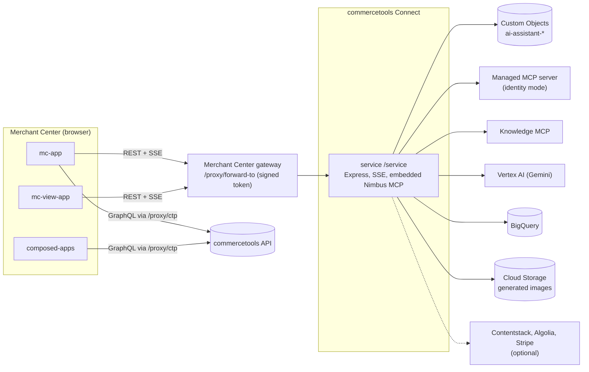

> **UNSUPPORTED - commercetools Labs.** This repository is freely available reference code,
> provided AS IS under the MIT license with **no support, no SLA and no roadmap commitment**.
> See [SUPPORT.md](./SUPPORT.md) and [LICENSE](./LICENSE).

# AI Assistant for the Merchant Center

An AI chat assistant for the commercetools Merchant Center, packaged as a commercetools Connect
connector. It is installed once per commercetools project.

- Status: unsupported (see [SUPPORT.md](./SUPPORT.md)).
- The folders `plans/` and `openspec/` hold the design documentation of the project. They imply no support.
- Documentation: this README is the connector README; the details are in [docs/](./docs) and in the
  README of each application folder.

## Overview

The connector has four Connect applications, all described by one [`connect.yaml`](./connect.yaml):

| Application | Folder | Connect type | What it is |
| --- | --- | --- | --- |
| `service` | [service/](./service/README.md) | `service`, endpoint `/service` | Express service: chat streaming, sessions, tool sources, feedback and backoffice APIs |
| `mc-app` | [mc-app/](./mc-app/README.md) | `merchant-center-custom-application` | The "AI Assistant" application: chat, settings, administrator screens, composed pages |
| `composed-apps` | [composed-apps/](./composed-apps/README.md) | `merchant-center-custom-application` | The "AI Assistant Pages" application: lists and renders pages the assistant created |
| `mc-view-app` | [mc-view-app/](./mc-view-app/README.md) | `merchant-center-custom-view` | A side panel on Merchant Center pages that knows which page is open |

What the assistant does:

- Streams chat answers from Gemini models on Vertex AI, with the conversation stored as commercetools Custom Objects.
- Reads and changes commerce data through a commercetools Managed MCP server in identity mode, so every user acts with their own Merchant Center permissions.
- Adds optional tool sources: the commercetools Knowledge MCP, Contentstack, Algolia, Stripe, the Nimbus design-system documentation (embedded), BigQuery for large results, and image generation.
- Builds interactive pages from a chat and stores them as Custom Objects ("composed pages").
- Offers administrators a system prompt, a tool-call log level, a transcript and feedback browser (backoffice) and Managed MCP setup.

The full feature inventory is in [FEATURES.md](./FEATURES.md).

## What it is not

- It is not supported by commercetools (see the banner above).
- It does not use a Subscription, an API Extension or a scheduled job, and it is never in the path of carts, orders or checkout.
- It has no database of its own: all state is in commercetools Custom Objects of the project it is installed in.
- It does not serve more than one commercetools project per installation.
- It does not ship a continuous-integration pipeline; deployment is a set of Connect CLI commands ([docs/deployment.md](./docs/deployment.md)).

## Architecture at a glance



The browser never calls the service directly: every request goes through the Merchant Center
gateway, which adds a short-lived signed token that the service verifies. See
[docs/architecture.md](./docs/architecture.md) and [docs/how-it-works.md](./docs/how-it-works.md).

## Repository layout

| Path | Contents |
| --- | --- |
| `connect.yaml` | The Connect contract: four applications, their configuration keys and the API client scopes |
| `service/` | The service (TypeScript, Express, npm) |
| `mc-app/`, `composed-apps/`, `mc-view-app/` | The Merchant Center applications (TypeScript, React, Yarn 1, one install per folder) |
| `contract/` | Shared test fixture of the composed page format |
| `docs/` | Documentation |
| `scripts/` | Repository checks, the deployment helper (`scripts/connect`) and the documentation checks (`scripts/docs`) |
| `plans/`, `openspec/` | Design documentation |

There are no npm workspaces and no shared package: each folder installs its own dependencies, as
Connect requires. A few small files are copied between the Merchant Center applications and kept
identical by `node scripts/check-duplicates.mjs`.

## Prerequisites

- Node.js 22 (npm for `service/` and `scripts/`, Yarn 1 for the three frontends).
- The commercetools Connect CLI (`@commercetools/cli`, version 0.0.17 or newer) and, for `commercetools connect validate`, a running Docker daemon.
- A commercetools project and a Merchant Center account that may register Custom Applications and a Custom View.
- A Google Cloud project with the Vertex AI, BigQuery and Cloud Storage APIs enabled and one service account key (roles are listed under [Required scopes](#required-scopes)).
- Optional: Contentstack, Algolia or Stripe credentials for the matching tool sources.

## Quick start (local)

The service can run on your machine with in-memory persistence and the Merchant Center token check switched off.
This mode is refused when `NODE_ENV=production` and never reaches Connect.

```
cd service
npm ci
cp .env.example .env.local
# edit .env.local: NODE_ENV=development, PERSISTENCE_DRIVER=memory, MC_AUTH_DISABLED=true,
# CTP_PROJECT_KEY=<your project key>, CTP_REGION=us-central1.gcp,
# ENCRYPTION_KEY=$(openssl rand -base64 32)
npm run start:dev
curl http://127.0.0.1:8080/service/status
curl -H 'x-dev-user-id: user-id-a' -H 'x-dev-admin: true' http://127.0.0.1:8080/service/session/all
```

Chat answers need `GCP_SA_KEY_BASE64`. The three frontends run with `yarn install && yarn start` in their folder
and need a registered Custom Application, a Merchant Center login and a reachable service; see each folder's README.
Full local instructions: [service/README.md](./service/README.md).

## Deployment summary

Deployment uses the Connect CLI through `node scripts/connect/connect.mjs`. First install, after the prerequisites:

1. Register the two Custom Applications and the Custom View in the Merchant Center with a placeholder URL.
2. `stage`, then `publish` the connector from your repository and tag.
3. `deploy` (phase 1), then `finalize` (phase 2: it sets `MC_AUDIENCE` and `CHAT_SERVICE_ENDPOINT_URL` from the service URL).
4. Put the printed application URLs into the Merchant Center registrations.
5. Read your user ID in the app and set `ADMIN_USER_IDS` with `configure`.

Read [docs/deployment.md](./docs/deployment.md) for the concepts and the exact order and
[docs/deployment-runbook.md](./docs/deployment-runbook.md) for the commands.

## Configuration

Every `connect.yaml` key, per application. Connect injects `CTP_API_URL`, `CTP_AUTH_URL`, `CTP_CLIENT_ID`,
`CTP_CLIENT_SECRET`, `CTP_PROJECT_KEY` and `CTP_SCOPE` into the service from the API client it creates; they are never declared.
The table is generated from `connect.yaml`; the notes are in [docs/configuration.md](./docs/configuration.md).

<!-- gen:begin config -->
<!-- Generated by scripts/docs/gen-config-table.mjs. Do not edit by hand. -->

**`service`** (service, endpoint `/service`)

| Key | Kind | Required | Default | Description |
| --- | --- | --- | --- | --- |
| `CTP_REGION` | standard | yes |  | commercetools API region of the project in API-host spelling (us-central1.gcp, europe-west1.gcp, australia-southeast1.gcp, eu-central-1.aws or us-east-2.aws). Connect does not inject it |
| `MC_CLOUD_IDENTIFIER` | standard | no |  | Optional override of the Merchant Center API gateway cloud identifier (for example gcp-us) that issues the session token. Empty means it is derived from CTP_REGION |
| `MC_APP_ENTRY_POINT_URI_PATH` | standard | no | `ai-assistant` | Entry point URI path of the chat Custom Application (used for logging and checks only) |
| `MC_AUDIENCE` | standard | no |  | Public origin of this service (https://host, no path). Unknown until the first deployment; set it with a redeploy (see the deployment runbook). While empty the service rejects all Merchant Center traffic |
| `GCP_PROJECT_ID` | standard | no |  | Google Cloud project that hosts Vertex AI, BigQuery and the image bucket. Optional; when empty the project_id inside the service-account key is used |
| `GCP_VERTEX_LOCATION` | standard | no | `us-central1` | Vertex AI location (Gemini text and image models) |
| `GEMINI_MODEL_NAME` | standard | no | `gemini-3.8-flash` | Main Gemini model id |
| `GEMINI_AGENT_MODEL_NAME` | standard | no | `gemini-2.5-flash` | Gemini model id for the Algolia, Stripe, export and Contentstack agents. Uses a 2.5-era thinking budget, so keep a 2.5 model unless you also change the thinking configuration |
| `GEMINI_LITE_MODEL_NAME` | standard | no | `gemini-3.5-flash-lite` | Cheap Gemini model id used for session digests and prompt suggestions |
| `GEMINI_LITE_THINKING_LEVEL` | standard | no | `minimal` | Thinking level of the cheap model (minimal, low, medium or high) |
| `GEMINI_IMAGE_MODEL_NAME` | standard | no | `gemini-2.5-flash-image` | Gemini model id used for image generation (must be available in GCP_VERTEX_LOCATION) |
| `GCP_BIGQUERY_DATASET_ID` | standard | no | `aiassistant` | BigQuery dataset for offloaded tool results (created on first use when the service account may create datasets) |
| `GCP_BIGQUERY_LOCATION` | standard | no | `us-central1` | BigQuery location of the dataset (immutable once the dataset exists) |
| `GCP_BUCKET_NAME` | standard | no |  | Cloud Storage bucket for generated images. Optional; when empty the name is <gcp project id>-ai-assistant-images |
| `GCP_BUCKET_LOCATION` | standard | no | `us-central1` | Location used when the bucket has to be created (us-central1, or a multi-region such as US) |
| `IMAGE_URL_MODE` | standard | no | `private` | private (default) = bucket stays private and images are streamed through the service; public = objects are publicly readable and stored with the public bucket URL |
| `MCP_TOOLS_TTL_MS` | standard | no | `1800000` | In-process cache lifetime of fetched MCP tool sets in milliseconds |
| `PERSISTENCE_CONCURRENCY` | standard | no | `8` | Maximum number of parallel Custom Object requests of bulk operations such as deleting a session (1 to 32) |
| `SETTINGS_CACHE_TTL_MS` | standard | no | `5000` | In-process cache lifetime of the stored settings in milliseconds (0 disables the cache, at most 60000) |
| `CHAT_REQUEST_BUDGET_MS` | standard | no | `270000` | Time one chat reply may take in milliseconds, at most 285000 (Connect times a request out after 5 minutes; the reply is finished gracefully when this is reached) |
| `CHAT_FINALIZE_RESERVE_MS` | standard | no | `30000` | Part of the chat time budget reserved for the final summary step, in milliseconds (5000 up to half the budget) |
| `NIMBUS_MCP_ENABLED` | standard | no | `true` | Kill switch of the embedded Nimbus design-system documentation tools (true or false). When false the Nimbus child process is never started |
| `LOG_LEVEL` | standard | no | `info` | Logger level (error, warn, info, debug) |
| `ADMIN_USER_IDS` | standard | no |  | Optional comma-separated list of Merchant Center user ids (at most 50) of administrators. A user is an administrator only when the user id in the signed Merchant Center gateway token is in this list. Empty means nobody is an administrator |
| `CONTENTSTACK_BRANCH` | standard | no |  | Optional Contentstack branch name sent with every Content Management API call |
| `CONTENTSTACK_REGION` | standard | no | `na` | Contentstack region of the stack (na, eu, au, azure-na, azure-eu, gcp-na, gcp-eu) |
| `STRIPE_CONNECTED_ACCOUNT_ID` | standard | no |  | Optional Stripe connected account id (acct_...) the Stripe tools act on behalf of |
| `GCP_SA_KEY_BASE64` | secured | yes |  | Base64 of the complete Google service-account JSON key (single line, no wrapping) |
| `ENCRYPTION_KEY` | secured | yes |  | Base64 of a 32-byte AES-256-GCM key that protects stored identity tokens; changing it makes stored tokens unreadable (see change E for rotation) |
| `ENCRYPTION_KEY_PREVIOUS` | secured | no |  | Optional comma-separated retired ENCRYPTION_KEY values (base64, 32 bytes each) used only to decrypt data written before a key rotation |
| `CONTENTSTACK_API_KEY` | secured | no |  | Optional Contentstack stack API key. Contentstack is enabled only when this and CONTENTSTACK_MANAGEMENT_TOKEN are both set |
| `CONTENTSTACK_MANAGEMENT_TOKEN` | secured | no |  | Optional Contentstack Management Token (scope it to what the assistant may change) |
| `ALGOLIA_MCP_URL` | secured | no |  | Optional https URL of the Algolia MCP server. Secured because it may embed a key; Algolia is enabled when it is set |
| `STRIPE_SECRET_KEY` | secured | no |  | Optional Stripe secret or restricted key (sk_/rk_). Prefer a restricted key limited to the tools you want the assistant to use |

**`mc-app`** (merchant-center-custom-application)

| Key | Kind | Required | Default | Description |
| --- | --- | --- | --- | --- |
| `CUSTOM_APPLICATION_ID` | standard | yes |  | The Custom Application ID returned when registering the application in the Merchant Center |
| `ENTRY_POINT_URI_PATH` | standard | yes |  | Entry point URI path of the Custom Application (unique per cloud region) |
| `CLOUD_IDENTIFIER` | standard | no | `gcp-us` | Merchant Center API cloud identifier (for example gcp-us) |
| `CHAT_SERVICE_ENDPOINT_URL` | standard | no | `https://not-configured.invalid/service` | Full URL of the service including /service; set on redeploy after the first deployment |

**`composed-apps`** (merchant-center-custom-application)

| Key | Kind | Required | Default | Description |
| --- | --- | --- | --- | --- |
| `CUSTOM_APPLICATION_ID` | standard | yes |  | The Custom Application ID returned when registering the Pages application in the Merchant Center |
| `ENTRY_POINT_URI_PATH` | standard | yes |  | Entry point URI path of the Pages Custom Application (unique per cloud region, different from the chat application) |
| `CLOUD_IDENTIFIER` | standard | no | `gcp-us` | Merchant Center API cloud identifier (for example gcp-us) |

**`mc-view-app`** (merchant-center-custom-view)

| Key | Kind | Required | Default | Description |
| --- | --- | --- | --- | --- |
| `CUSTOM_VIEW_ID` | standard | yes |  | The Custom View ID returned when registering the view in the Merchant Center |
| `CLOUD_IDENTIFIER` | standard | no | `gcp-us` | Merchant Center API cloud identifier (for example gcp-us) |
| `CHAT_SERVICE_ENDPOINT_URL` | standard | no | `https://not-configured.invalid/service` | Full URL of the service including /service; set on redeploy after the first deployment |

<!-- gen:end config -->

Third-party provider keys (`CONTENTSTACK_*`, `ALGOLIA_MCP_URL`, `STRIPE_*`) are Connect configuration only. A provider is enabled
when all of its required keys are set and valid; otherwise it is disabled and a warning is logged at start.

## Administrator access

An administrator is a user whose Merchant Center user ID is listed in the Connect configuration `ADMIN_USER_IDS`
(optional, comma-separated, at most 50 entries). The service decides this on every request from the user ID inside
the signed gateway token. Nothing the browser sends (e-mail, label, flag) is ever trusted.

- Empty or unset `ADMIN_USER_IDS` means nobody is an administrator (fail closed). The service logs `ADMIN_USER_IDS is empty: no administrator` at start.
- To find your own ID, open the app, then Settings, About: the "Your user ID" line is shown to every user (the panel shows it in its footer).
- First administrator: deploy, read the ID, run `node scripts/connect/connect.mjs configure ADMIN_USER_IDS=<id>` and refresh the app after the instances restart.
- Non-administrators see no administrator screens and get HTTP 403 with code `ADMIN_REQUIRED` from administrator routes. Chat, sessions and connecting their own account keep working.
- No Merchant Center permission grants administrator rights. The apps only use their default View and Manage permission pair, which controls access to the app.

Details: [docs/permissions.md](./docs/permissions.md).

## Required scopes

Generated from `connect.yaml` and the configuration files of the applications.

<!-- gen:begin scopes -->
<!-- Generated by scripts/docs/gen-config-table.mjs. Do not edit by hand. -->

**API client scopes of the service** (`inheritAs.apiClient.scopes` in `connect.yaml`)

| Scope | Why the service needs it |
| --- | --- |
| `view_key_value_documents` | Reads sessions, messages, settings, feedback and the other Custom Objects that hold the assistant's state, and reads the composed pages |
| `manage_key_value_documents` | Creates, updates and deletes those Custom Objects (chat history, settings, encrypted identity tokens, feedback, composed pages) |

**OAuth scopes of the Merchant Center applications and the Custom View** (`oAuthScopes` of each config file)

| Scope | Access | Used by | Why |
| --- | --- | --- | --- |
| `view_key_value_documents` | view | `mc-app`, `composed-apps`, `mc-view-app` | Reads the composed pages stored as Custom Objects; in the Custom View the list only has to be non-empty |
| `view_mcp_servers` | view | `mc-app`, `mc-view-app` | Lists Managed MCP servers with the signed-in user's own permissions (administrator setup screen of the chat application; the Custom View declares it for parity and does not use it) |
| `view_stores` | view | `mc-app`, `composed-apps` | Commerce data that generated pages read (view) or change (manage) with the signed-in user's own token |
| `view_tax_categories` | view | `mc-app`, `composed-apps` | Commerce data that generated pages read (view) or change (manage) with the signed-in user's own token |
| `view_products` | view | `mc-app`, `composed-apps` | Commerce data that generated pages read (view) or change (manage) with the signed-in user's own token |
| `view_product_selections` | view | `mc-app`, `composed-apps` | Commerce data that generated pages read (view) or change (manage) with the signed-in user's own token |
| `view_categories` | view | `mc-app`, `composed-apps` | Commerce data that generated pages read (view) or change (manage) with the signed-in user's own token |
| `view_standalone_prices` | view | `mc-app`, `composed-apps` | Commerce data that generated pages read (view) or change (manage) with the signed-in user's own token |
| `view_cart_discounts` | view | `mc-app`, `composed-apps` | Commerce data that generated pages read (view) or change (manage) with the signed-in user's own token |
| `view_discount_codes` | view | `mc-app`, `composed-apps` | Commerce data that generated pages read (view) or change (manage) with the signed-in user's own token |
| `view_customers` | view | `mc-app`, `composed-apps` | Commerce data that generated pages read (view) or change (manage) with the signed-in user's own token |
| `view_customer_groups` | view | `mc-app`, `composed-apps` | Commerce data that generated pages read (view) or change (manage) with the signed-in user's own token |
| `view_business_units` | view | `mc-app`, `composed-apps` | Commerce data that generated pages read (view) or change (manage) with the signed-in user's own token |
| `view_orders` | view | `mc-app`, `composed-apps` | Commerce data that generated pages read (view) or change (manage) with the signed-in user's own token |
| `view_payment_methods` | view | `mc-app`, `composed-apps` | Commerce data that generated pages read (view) or change (manage) with the signed-in user's own token |
| `view_shopping_lists` | view | `mc-app`, `composed-apps` | Commerce data that generated pages read (view) or change (manage) with the signed-in user's own token |
| `view_shipping_methods` | view | `mc-app`, `composed-apps` | Commerce data that generated pages read (view) or change (manage) with the signed-in user's own token |
| `view_quote_requests` | view | `mc-app`, `composed-apps` | Commerce data that generated pages read (view) or change (manage) with the signed-in user's own token |
| `view_staged_quotes` | view | `mc-app`, `composed-apps` | Commerce data that generated pages read (view) or change (manage) with the signed-in user's own token |
| `view_quotes` | view | `mc-app`, `composed-apps` | Commerce data that generated pages read (view) or change (manage) with the signed-in user's own token |
| `manage_key_value_documents` | manage | `mc-app`, `mc-view-app` | Lets the chat application save and delete composed pages; in the Custom View the list only has to be non-empty |
| `manage_stores` | manage | `mc-app`, `composed-apps` | Commerce data that generated pages read (view) or change (manage) with the signed-in user's own token |
| `manage_tax_categories` | manage | `mc-app`, `composed-apps` | Commerce data that generated pages read (view) or change (manage) with the signed-in user's own token |
| `manage_products` | manage | `mc-app`, `composed-apps` | Commerce data that generated pages read (view) or change (manage) with the signed-in user's own token |
| `manage_product_selections` | manage | `mc-app`, `composed-apps` | Commerce data that generated pages read (view) or change (manage) with the signed-in user's own token |
| `manage_categories` | manage | `mc-app`, `composed-apps` | Commerce data that generated pages read (view) or change (manage) with the signed-in user's own token |
| `manage_standalone_prices` | manage | `mc-app`, `composed-apps` | Commerce data that generated pages read (view) or change (manage) with the signed-in user's own token |
| `manage_cart_discounts` | manage | `mc-app`, `composed-apps` | Commerce data that generated pages read (view) or change (manage) with the signed-in user's own token |
| `manage_customers` | manage | `mc-app`, `composed-apps` | Commerce data that generated pages read (view) or change (manage) with the signed-in user's own token |
| `manage_customer_groups` | manage | `mc-app`, `composed-apps` | Commerce data that generated pages read (view) or change (manage) with the signed-in user's own token |
| `manage_business_units` | manage | `mc-app`, `composed-apps` | Commerce data that generated pages read (view) or change (manage) with the signed-in user's own token |
| `manage_orders` | manage | `mc-app`, `composed-apps` | Commerce data that generated pages read (view) or change (manage) with the signed-in user's own token |
| `manage_payment_methods` | manage | `mc-app`, `composed-apps` | Commerce data that generated pages read (view) or change (manage) with the signed-in user's own token |
| `manage_shopping_lists` | manage | `mc-app`, `composed-apps` | Commerce data that generated pages read (view) or change (manage) with the signed-in user's own token |
| `manage_shipping_methods` | manage | `mc-app`, `composed-apps` | Commerce data that generated pages read (view) or change (manage) with the signed-in user's own token |
| `manage_quote_requests` | manage | `mc-app`, `composed-apps` | Commerce data that generated pages read (view) or change (manage) with the signed-in user's own token |
| `manage_staged_quotes` | manage | `mc-app`, `composed-apps` | Commerce data that generated pages read (view) or change (manage) with the signed-in user's own token |
| `manage_quotes` | manage | `mc-app`, `composed-apps` | Commerce data that generated pages read (view) or change (manage) with the signed-in user's own token |
| `manage_mcp_servers` | manage | `mc-app`, `mc-view-app` | Creates Managed MCP servers with the signed-in user's own permissions (administrator setup screen of the chat application; the Custom View declares it for parity and does not use it) |
| `manage_approval_flows` | manage | `mc-app` | Commerce data that generated pages read (view) or change (manage) with the signed-in user's own token |
| `manage_approval_rules` | manage | `mc-app` | Commerce data that generated pages read (view) or change (manage) with the signed-in user's own token |
| `manage_associate_roles` | manage | `mc-app` | Commerce data that generated pages read (view) or change (manage) with the signed-in user's own token |
| `manage_attribute_groups` | manage | `mc-app` | Commerce data that generated pages read (view) or change (manage) with the signed-in user's own token |
| `manage_discount_codes` | manage | `mc-app` | Commerce data that generated pages read (view) or change (manage) with the signed-in user's own token |
| `manage_project_settings` | manage | `mc-app` | Commerce data that generated pages read (view) or change (manage) with the signed-in user's own token |
| `manage_order_edits` | manage | `mc-app` | Commerce data that generated pages read (view) or change (manage) with the signed-in user's own token |
| `manage_payments` | manage | `mc-app` | Commerce data that generated pages read (view) or change (manage) with the signed-in user's own token |
| `manage_recurring_orders` | manage | `mc-app` | Commerce data that generated pages read (view) or change (manage) with the signed-in user's own token |
| `manage_recurring_payments` | manage | `mc-app` | Commerce data that generated pages read (view) or change (manage) with the signed-in user's own token |
| `manage_recurrence_policies` | manage | `mc-app` | Commerce data that generated pages read (view) or change (manage) with the signed-in user's own token |
| `manage_states` | manage | `mc-app` | Commerce data that generated pages read (view) or change (manage) with the signed-in user's own token |
| `manage_types` | manage | `mc-app` | Commerce data that generated pages read (view) or change (manage) with the signed-in user's own token |

<!-- gen:end scopes -->

The key `ENCRYPTION_KEY` protects stored identity tokens. The service-account key in `GCP_SA_KEY_BASE64` needs these Google Cloud roles:

| Role | Why |
| --- | --- |
| `roles/aiplatform.user` | Gemini models on Vertex AI |
| `roles/bigquery.jobUser` | Runs queries and load jobs |
| `roles/bigquery.dataEditor` | Creates the dataset and the temporary tables of offloaded tool results |
| `roles/storage.admin` on the project, or `roles/storage.objectAdmin` on a bucket you create yourself | Stores generated images; the first option lets the service create the private bucket, the second is the least-privilege option |

Merchant Center users need the default View permission of an application to open it. Managing a Managed MCP server needs
`manage_mcp_servers` in the user's own project permissions. See [docs/permissions.md](./docs/permissions.md).

## Fail-open and fail-closed behaviour

What happens when a dependency is unavailable. "Closed" means the request is rejected, "open" means it continues without the dependency.

| Dependency | When unavailable | Stance | Time limit |
| --- | --- | --- | --- |
| Merchant Center token verification | Any token that cannot be verified, including an unreachable key set, gets 401 | closed | set by the verification library |
| `MC_AUDIENCE` not set | Every authenticated route answers 401 until it is set | closed | none |
| Project key in the token differs from the deployment | 403 | closed | none |
| `ADMIN_USER_IDS` empty | Nobody is an administrator; administrator routes answer 403 `ADMIN_REQUIRED` | closed | none |
| commercetools Custom Objects | Session, settings and feedback routes answer 503; a chat turn does not start; `/service/status` stays `UP` | closed | 15 s per request, up to 3 tries |
| Vertex AI | The chat turn ends with an error message in the stream; digests and suggestions fall back to defaults | closed for chat, open for digests and suggestions | whole turn 270 s |
| Identity Managed MCP | Commerce tools are replaced by a "not connected" notice; chat continues with other sources | open | 15 s per source |
| Knowledge MCP, Contentstack, Algolia, Stripe | The failing source contributes no tools for that turn | open | 10 s handshake, 15 s per source |
| Embedded Nimbus MCP | Its tools are left out; `/service/status/nimbus` answers 503 | open | 20 s per call |
| BigQuery | Offloading a large result fails: the tool result is returned unchanged; query tools return an error to the model | open for offload, closed per query | 60 s per query job |
| Cloud Storage | A generated image that cannot be stored is dropped and logged; an image that cannot be read answers 404 or 500 for that file | open for chat, closed per image | none |
| Five-minute Connect request limit | At 240 s running tools stop; at 270 s the answer is finished with a notice that is stored | closed with a message | `CHAT_REQUEST_BUDGET_MS`, `CHAT_FINALIZE_RESERVE_MS` |

No Subscription or API Extension exists, so orders, carts and checkout never depend on this connector.
Details and the code references are in [docs/operations.md](./docs/operations.md).

## Operations

- Health: `GET /service/status` answers `{"status":"UP", ...}` without calling any dependency; `GET /service/status/nimbus` checks the embedded Nimbus child.
- Logs: JSON lines on standard output; set `LOG_LEVEL` (`error`, `warn`, `info`, `debug`) and `LOG_HTTP=true` for one line per request. Secrets, tokens and message content are never logged.
- Correlation: send `X-Correlation-Id` (otherwise one is generated); it is the `correlationId` field of every log line of that request.
- Audit: administrator actions log `audit.admin_action` with the user ID, route and outcome, never an e-mail address.
- Data retention: chat messages and feedback are kept until an operator deletes them. There is no automatic deletion, expiry or cleanup job. See [docs/operations.md](./docs/operations.md#data-retention).

## Poison messages and replay

Not applicable. The connector contains only a `service` application and Merchant Center frontends. It registers no
Subscription, API Extension or scheduled job, receives no commercetools messages and therefore has no redelivery,
dead-letter or replay behaviour. Recovery paths: retry the chat turn in the app, delete a session, reconnect the
identity connection, or redeploy. See [docs/operations.md](./docs/operations.md#poison-messages-and-replay).

## Testing

- Service: `cd service && npm ci && npm test` (Jest, in-memory persistence, no network). `npm run typecheck`, `npm run lint` and `npm run check:foundation` are the other gates.
- Frontends: `yarn typecheck && yarn lint && yarn test && yarn build` in each folder (the build needs the variables of `.env.example`).
- Repository checks: `node scripts/spdx-check.mjs`, `node scripts/check-repo-rules.mjs`, `node scripts/check-connect-layout.mjs`, `node scripts/check-duplicates.mjs`.
- Documentation checks: `node scripts/docs/gen-config-table.mjs --check`, `check-links.mjs`, `check-api-doc.mjs`, `check-docs-claims.mjs`.
- Live checks against a deployed connector need a Merchant Center login and are run by hand.

## Contributing

See [CONTRIBUTING.md](./CONTRIBUTING.md). Contributions carry no support commitment.

## Support

This repository is unsupported. See [SUPPORT.md](./SUPPORT.md).

## License

MIT, see [LICENSE](./LICENSE).
