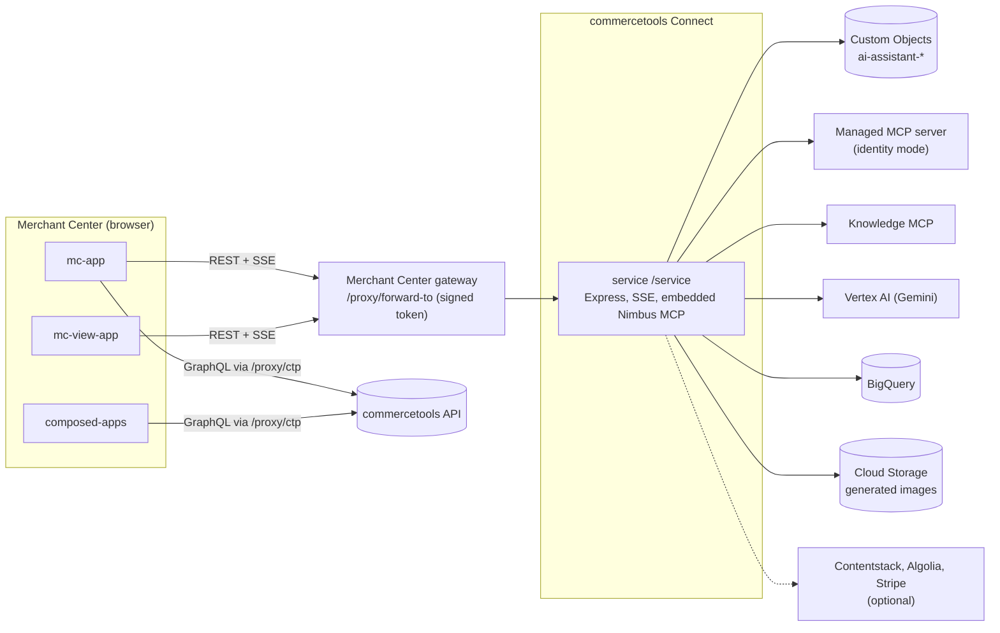

> **commercetools Labs, unsupported.** Freely available reference code under the MIT license,
> shared as-is and not covered by commercetools support. See [SUPPORT.md](./SUPPORT.md) and [LICENSE](./LICENSE).

# AI Assistant for the Merchant Center

Ask your commerce data a question in plain language, right inside the Merchant Center.

Merchants and developers spend a lot of time clicking through lists and filters to answer simple questions ("which orders from last week are still unpaid?") or to make small repetitive changes. This connector adds a chat assistant to the Merchant Center that does that work for you. It uses Gemini on Google Vertex AI and a commercetools Managed MCP server, so every person acts with their own Merchant Center permissions and sees only what they are allowed to see.

When it works, you get an "AI Assistant" application with chat, a side panel on Merchant Center pages that knows which page you are on, and pages the assistant builds for you. It installs once per commercetools project through commercetools Connect (version 0.1.0).

This is shared as reference code: free to use and adapt, as-is, and unsupported by commercetools. Details are in [SUPPORT.md](./SUPPORT.md).

This README is the connector README: its configuration, scopes and failure behaviour. Everything else is in the guides below.

| I want to | Read |
| --- | --- |
| Use the assistant | [docs/using-the-assistant.md](./docs/using-the-assistant.md) |
| Set up Google Cloud, Gemini, the service account, the bucket and other accounts | [docs/setup.md](./docs/setup.md) |
| Deploy the connector with Connect | [docs/connect-deployment.md](./docs/connect-deployment.md), commands in [docs/deployment-runbook.md](./docs/deployment-runbook.md) |
| Run, test and change the code | [docs/development.md](./docs/development.md) |
| Look up a configuration key | [docs/configuration.md](./docs/configuration.md) |
| Understand how it works | [docs/architecture.md](./docs/architecture.md), [docs/how-it-works.md](./docs/how-it-works.md), [FEATURES.md](./FEATURES.md) |
| Add a data store or a tool source | [docs/adding-a-store.md](./docs/adding-a-store.md) |
| Operate it or fix a problem | [docs/operations.md](./docs/operations.md), [docs/troubleshooting.md](./docs/troubleshooting.md) |
| Review security, permissions and privacy | [docs/security.md](./docs/security.md), [docs/permissions.md](./docs/permissions.md), [docs/privacy.md](./docs/privacy.md) |
| Call the service API | [docs/api.md](./docs/api.md) |

## Overview

The connector has four Connect applications, all described by one [`connect.yaml`](./connect.yaml):

| Application | Folder | Connect type | What it is |
| --- | --- | --- | --- |
| `service` | [service/](./service/README.md) | `service`, endpoint `/service` | Express service: chat streaming, sessions, tool sources, feedback and backoffice APIs |
| `mc-app` | [mc-app/](./mc-app/README.md) | `merchant-center-custom-application` | The "AI Assistant" application: chat, settings, administrator screens, composed pages |
| `composed-apps` | [composed-apps/](./composed-apps/README.md) | `merchant-center-custom-application` | The "AI Assistant Pages" application: lists and renders pages the assistant created |
| `mc-view-app` | [mc-view-app/](./mc-view-app/README.md) | `merchant-center-custom-view` | A side panel on Merchant Center pages that knows which page is open |

What the assistant does:

- Streams chat answers from Gemini models on Vertex AI, with the conversation stored as commercetools Custom Objects.
- Reads and changes commerce data through a commercetools Managed MCP server in identity mode, so every user acts with their own Merchant Center permissions.
- Adds optional tool sources: the commercetools Knowledge MCP, Contentstack, Algolia, Stripe, the Nimbus design-system documentation (embedded), BigQuery for large results, and image generation.
- Builds interactive pages from a chat and stores them as Custom Objects ("composed pages").
- Offers administrators a system prompt, a tool-call log level, a transcript and feedback browser (backoffice) and Managed MCP setup.

## What it is not

- It is not supported by commercetools (see the banner above).
- It does not use a Subscription, an API Extension or a scheduled job, and it is never in the path of carts, orders or checkout.
- It has no database of its own: all state is in commercetools Custom Objects of the project it is installed in.
- It does not serve more than one commercetools project per installation.
- It does not ship a continuous-integration pipeline; deployment is a set of Connect CLI commands ([docs/connect-deployment.md](./docs/connect-deployment.md)).

## Architecture at a glance



The browser never calls the service directly: every request goes through the Merchant Center
gateway, which adds a short-lived signed token that the service verifies. See
[docs/architecture.md](./docs/architecture.md) and [docs/how-it-works.md](./docs/how-it-works.md).

## Repository layout

`service/` is the service (npm); `mc-app/`, `composed-apps/` and `mc-view-app/` are the Merchant Center applications (Yarn 1, one install per folder, no workspaces, as Connect requires);
`connect.yaml` is the Connect contract; `docs/` holds the documentation and `scripts/` the deployment helper.
The full table is in [docs/development.md](./docs/development.md#repository-layout).

## Prerequisites

- Node.js 22, Yarn 1, a running Docker daemon and the Connect CLI (`@commercetools/cli` 0.0.17 or newer).
- A commercetools project, a Merchant Center account that may register Custom Applications and a Custom View, and a Connect API client.
- A Google Cloud project with Vertex AI, BigQuery and Cloud Storage enabled and one service-account key.
- Optional: Contentstack, Algolia or Stripe credentials.

How to create each of these is in [docs/setup.md](./docs/setup.md).

## Quick start (local)

The service can run on your machine with in-memory persistence and the Merchant Center token check switched off.
This mode is refused when `NODE_ENV=production` and never reaches Connect.

```
cd service
npm ci
cp .env.example .env.local     # set the values listed in docs/development.md
npm run start:dev
curl http://127.0.0.1:8080/service/status
```

Chat answers need `GCP_SA_KEY_BASE64`. The three frontends run with `yarn install && yarn start` in their folder.
Which values to set, how a frontend reaches the local service and how to try the Managed MCP connect flow: [docs/development.md](./docs/development.md).

## Deployment summary

The deployment runs **twice**, because the Merchant Center applications need the real `CHAT_SERVICE_ENDPOINT_URL`, which exists only after the service has been deployed once.
It uses the Connect CLI through `node scripts/connect/connect.mjs`.

1. Register the two Custom Applications and the Custom View in the Merchant Center with a placeholder URL.
2. `stage`, then `publish` the connector from your repository and tag.
3. `deploy`: the first deployment, with everything except `CHAT_SERVICE_ENDPOINT_URL`.
4. `finalize`: the second deployment, a redeploy that passes `CHAT_SERVICE_ENDPOINT_URL` (the service URL plus `/service`).
5. Put the printed application URLs into the Merchant Center registrations.
6. Read your user ID in the app and set `ADMIN_USER_IDS` with `configure`.

The path with a diagram, and why the order matters: [docs/connect-deployment.md](./docs/connect-deployment.md). Commands: [docs/deployment-runbook.md](./docs/deployment-runbook.md).

## Configuration

Every `connect.yaml` key, per application, with its default. A key without a fixed default says what happens when it is empty in its description.
Connect injects `CTP_API_URL`, `CTP_AUTH_URL`, `CTP_CLIENT_ID`, `CTP_CLIENT_SECRET`, `CTP_PROJECT_KEY` and `CTP_SCOPE` into the service from the API client it creates; they are never declared.
The table mirrors `connect.yaml`; the notes are in [docs/configuration.md](./docs/configuration.md).

**`service`** (service, endpoint `/service`)

| Key | Kind | Required | Default | Description |
| --- | --- | --- | --- | --- |
| `CTP_REGION` | standard | yes |  | commercetools API region of the project in API-host spelling (us-central1.gcp, europe-west1.gcp, australia-southeast1.gcp, eu-central-1.aws or us-east-2.aws). Connect does not inject it. No default, required |
| `MC_APP_ENTRY_POINT_URI_PATH` | standard | no | `ai-assistant` | Entry point URI path of the chat Custom Application (used for logging and checks only) |
| `ADMIN_USER_IDS` | standard | no |  | Optional comma-separated list of Merchant Center user ids (at most 50) of administrators. A user is an administrator only when the user id in the signed Merchant Center gateway token is in this list. Empty means nobody is an administrator. Default is empty, so nobody is an administrator |
| `MCP_BINDING_OPEN_TO_ALL` | standard | no | `false` | Feature flag. When true every verified Merchant Center user, not only an administrator from ADMIN_USER_IDS, may create, change and delete the shared Managed MCP (identity) binding. Nothing else loses its administrator gate (true or false) |
| `GCP_PROJECT_ID` | standard | no |  | Google Cloud project that hosts Vertex AI, BigQuery and the image bucket. Optional. Default is the project_id inside the service-account key |
| `GCP_VERTEX_LOCATION` | standard | no | `us-central1` | Vertex AI location (Gemini text and image models) |
| `GEMINI_MODEL_NAME` | standard | no | `gemini-3.8-flash` | Main Gemini model id. Used by the chat orchestrator and by the Algolia, Stripe, export and Contentstack agents, all with a high thinking level |
| `GEMINI_LITE_MODEL_NAME` | standard | no | `gemini-3.5-flash-lite` | Cheap Gemini model id used for session digests and prompt suggestions |
| `GEMINI_LITE_THINKING_LEVEL` | standard | no | `minimal` | Thinking level of the cheap model (minimal, low, medium or high) |
| `GEMINI_IMAGE_MODEL_NAME` | standard | no | `gemini-2.5-flash-image` | Gemini model id used for image generation (must be available in GCP_VERTEX_LOCATION) |
| `GCP_BIGQUERY_DATASET_ID` | standard | no | `aiassistant` | BigQuery dataset for offloaded tool results (created on first use when the service account may create datasets) |
| `GCP_BIGQUERY_LOCATION` | standard | no | `us-central1` | BigQuery location of the dataset (immutable once the dataset exists) |
| `GCP_BUCKET_NAME` | standard | no |  | Cloud Storage bucket for generated images. Optional. Default is <gcp project id>-ai-assistant-images |
| `GCP_BUCKET_LOCATION` | standard | no | `us-central1` | Location used when the bucket has to be created (us-central1, or a multi-region such as US) |
| `IMAGE_URL_MODE` | standard | no | `private` | private (default) = bucket stays private and images are streamed through the service; public = objects are publicly readable and stored with the public bucket URL |
| `CHAT_REQUEST_BUDGET_MS` | standard | no | `270000` | Time one chat reply may take in milliseconds, at most 285000 (Connect times a request out after 5 minutes; the reply is finished gracefully when this is reached) |
| `CHAT_FINALIZE_RESERVE_MS` | standard | no | `30000` | Part of the chat time budget reserved for the final summary step, in milliseconds (5000 up to half the budget) |
| `CHAT_DIGEST_BEFORE_CLOSE` | standard | no | `false` | When true the chat stream waits up to 3 seconds for the session digest before closing (true or false) |
| `MCP_TOOLS_TTL_MS` | standard | no | `1800000` | In-process cache lifetime of fetched MCP tool sets in milliseconds |
| `MCP_HANDSHAKE_TIMEOUT_MS` | standard | no | `10000` | Time in milliseconds a third-party MCP server may take to complete its handshake before it is skipped for the turn (at least 1) |
| `NIMBUS_MCP_ENABLED` | standard | no | `true` | Kill switch of the embedded Nimbus design-system documentation tools (true or false). When false the Nimbus child process is never started |
| `PERSISTENCE_CONCURRENCY` | standard | no | `8` | Maximum number of parallel Custom Object requests of bulk operations such as deleting a session (1 to 32) |
| `SETTINGS_CACHE_TTL_MS` | standard | no | `5000` | In-process cache lifetime of the stored settings in milliseconds (0 disables the cache, at most 60000) |
| `CACHE_MAX_ENTRIES` | standard | no | `5000` | Maximum number of entries of the in-process cache (at least 1) |
| `CACHE_SWEEP_MS` | standard | no | `60000` | Interval in milliseconds at which expired in-process cache entries are removed (at least 1) |
| `LOG_LEVEL` | standard | no | `info` | Logger level (error, warn, info, debug) |
| `LOG_HTTP` | standard | no | `false` | true logs one line per request without bodies or credentials (true or false) |
| `CONTENTSTACK_REGION` | standard | no | `na` | Contentstack region of the stack (na, eu, au, azure-na, azure-eu, gcp-na, gcp-eu) |
| `CONTENTSTACK_BRANCH` | standard | no |  | Optional Contentstack branch name sent with every Content Management API call. Default is empty, so no branch header is sent |
| `STRIPE_CONNECTED_ACCOUNT_ID` | standard | no |  | Optional Stripe connected account id (acct_...) the Stripe tools act on behalf of. Default is empty, so the Stripe tools act on the account of the key |
| `GCP_SA_KEY_BASE64` | secured | yes |  | Base64 of the complete Google service-account JSON key (single line, no wrapping). No default, required |
| `ENCRYPTION_KEY` | secured | yes |  | Base64 of a 32-byte AES-256-GCM key that protects stored identity tokens; changing it makes stored tokens unreadable (rotation is described in the configuration guide). No default, required |
| `ENCRYPTION_KEY_PREVIOUS` | secured | no |  | Optional comma-separated retired ENCRYPTION_KEY values (base64, 32 bytes each) used only to decrypt data written before a key rotation. Default is unset |
| `CONTENTSTACK_API_KEY` | secured | no |  | Optional Contentstack stack API key. Contentstack is enabled only when this and CONTENTSTACK_MANAGEMENT_TOKEN are both set. Default is unset |
| `CONTENTSTACK_MANAGEMENT_TOKEN` | secured | no |  | Optional Contentstack Management Token (scope it to what the assistant may change). Default is unset |
| `ALGOLIA_MCP_URL` | secured | no |  | Optional https URL of the Algolia MCP server. Secured because it may embed a key; Algolia is enabled when it is set. Default is unset |
| `STRIPE_SECRET_KEY` | secured | no |  | Optional Stripe secret or restricted key (sk_/rk_). Prefer a restricted key limited to the tools you want the assistant to use. Default is unset |

**`mc-app`** (merchant-center-custom-application)

| Key | Kind | Required | Default | Description |
| --- | --- | --- | --- | --- |
| `CUSTOM_APPLICATION_ID` | standard | yes |  | The Custom Application ID returned when registering the application in the Merchant Center. No default, required |
| `ENTRY_POINT_URI_PATH` | standard | yes |  | Entry point URI path of the Custom Application (unique per cloud region). No default, required |

**`composed-apps`** (merchant-center-custom-application)

| Key | Kind | Required | Default | Description |
| --- | --- | --- | --- | --- |
| `CUSTOM_APPLICATION_ID` | standard | yes |  | The Custom Application ID returned when registering the Pages application in the Merchant Center. No default, required |
| `ENTRY_POINT_URI_PATH` | standard | yes |  | Entry point URI path of the Pages Custom Application (unique per cloud region, different from the chat application). No default, required |

**`mc-view-app`** (merchant-center-custom-view)

| Key | Kind | Required | Default | Description |
| --- | --- | --- | --- | --- |
| `CUSTOM_VIEW_ID` | standard | yes |  | The Custom View ID returned when registering the view in the Merchant Center. No default, required |

**Shared by all applications** (`inheritAs.configuration` in `connect.yaml`, set once per deployment without an application prefix)

| Key | Kind | Required | Default | Description |
| --- | --- | --- | --- | --- |
| `CLOUD_IDENTIFIER` | standard | yes | `gcp-us` | Merchant Center API cloud identifier (for example gcp-us). Required by the Connect validator for Merchant Center applications; the default is gcp-us |
| `CHAT_SERVICE_ENDPOINT_URL` | standard | no | `https://not-configured.invalid/service` | Full URL of the service including /service; set on redeploy after the first deployment |

Third-party provider keys (`CONTENTSTACK_*`, `ALGOLIA_MCP_URL`, `STRIPE_*`) are Connect configuration only. A provider is enabled
when all of its required keys are set and valid; otherwise it is disabled and a warning is logged at start.

## Administrator access

An administrator is a user whose Merchant Center user ID is listed in the Connect configuration `ADMIN_USER_IDS`
(optional, comma-separated, at most 50 entries). The service decides this on every request from the user ID inside
the signed gateway token. Nothing the browser sends is ever trusted.

- Empty or unset `ADMIN_USER_IDS` means nobody is an administrator (fail closed).
- To find your own ID, open the app, then Settings, About: the "Your user ID" line is shown to every user.
- First administrator: deploy, read the ID, run `node scripts/connect/connect.mjs configure ADMIN_USER_IDS=<id>`.
- Non-administrators see no administrator screens and get HTTP 403 with code `ADMIN_REQUIRED` from administrator routes.
- `MCP_BINDING_OPEN_TO_ALL=true` opens only the shared Managed MCP binding to every user; nothing else.

Details: [docs/permissions.md](./docs/permissions.md).

## Required scopes

Taken from `connect.yaml` and the configuration files of the applications.

**API client scopes of the service** (`inheritAs.apiClient.scopes` in `connect.yaml`)

| Scope | Why the service needs it |
| --- | --- |
| `view_key_value_documents` | Reads sessions, messages, settings, feedback and the other Custom Objects that hold the assistant's state, and reads the composed pages |
| `manage_key_value_documents` | Creates, updates and deletes those Custom Objects (chat history, settings, encrypted identity tokens, feedback, composed pages) |

**OAuth scopes of the Merchant Center applications and the Custom View** (`oAuthScopes` of each config file)

| Scope | Access | Used by | Why |
| --- | --- | --- | --- |
| `view_key_value_documents` | view | `mc-app`, `composed-apps`, `mc-view-app` | Reads the composed pages stored as Custom Objects; in the Custom View the list only has to be non-empty |
| `view_mcp_servers` | view | `mc-app`, `mc-view-app` | Lists Managed MCP servers with the signed-in user's own permissions (administrator setup screen of the chat application; the Custom View declares it for parity and does not use it) |
| `view_stores`, `view_tax_categories`, `view_products`, `view_product_selections`, `view_categories`, `view_standalone_prices`, `view_cart_discounts`, `view_discount_codes`, `view_customers`, `view_customer_groups`, `view_business_units`, `view_orders`, `view_payment_methods`, `view_shopping_lists`, `view_shipping_methods`, `view_quote_requests`, `view_staged_quotes`, `view_quotes` | view | `mc-app`, `composed-apps` | Commerce data that generated pages read (view) or change (manage) with the signed-in user's own token |
| `manage_key_value_documents` | manage | `mc-app`, `mc-view-app` | Lets the chat application save and delete composed pages; in the Custom View the list only has to be non-empty |
| `manage_stores`, `manage_tax_categories`, `manage_products`, `manage_product_selections`, `manage_categories`, `manage_standalone_prices`, `manage_cart_discounts`, `manage_customers`, `manage_customer_groups`, `manage_business_units`, `manage_orders`, `manage_payment_methods`, `manage_shopping_lists`, `manage_shipping_methods`, `manage_quote_requests`, `manage_staged_quotes`, `manage_quotes` | manage | `mc-app`, `composed-apps` | Commerce data that generated pages read (view) or change (manage) with the signed-in user's own token |
| `manage_mcp_servers` | manage | `mc-app`, `mc-view-app` | Creates Managed MCP servers with the signed-in user's own permissions (administrator setup screen of the chat application; the Custom View declares it for parity and does not use it) |
| `manage_approval_flows`, `manage_approval_rules`, `manage_associate_roles`, `manage_attribute_groups`, `manage_discount_codes`, `manage_project_settings`, `manage_order_edits`, `manage_payments`, `manage_recurring_orders`, `manage_recurring_payments`, `manage_recurrence_policies`, `manage_states`, `manage_types` | manage | `mc-app` | Commerce data that generated pages read (view) or change (manage) with the signed-in user's own token |

The Google service account behind `GCP_SA_KEY_BASE64` needs `roles/aiplatform.user`, `roles/bigquery.jobUser`, `roles/bigquery.dataEditor` and either
`roles/storage.admin` on the project or `roles/storage.objectAdmin` on a bucket you create; the commands are in [docs/setup.md](./docs/setup.md#3-service-account-and-key).
Merchant Center users need the default View permission of an application to open it. Managing a Managed MCP server needs
`manage_mcp_servers` in the user's own project permissions. See [docs/permissions.md](./docs/permissions.md).

## Fail-open and fail-closed behaviour

What happens when a dependency is unavailable. "Closed" means the request is rejected, "open" means it continues without the dependency.

| Dependency | When unavailable | Stance | Time limit |
| --- | --- | --- | --- |
| Merchant Center token verification | Any token that cannot be verified, including an unreachable key set, gets 401 | closed | set by the verification library |
| `CONNECT_SERVICE_URL` not available to the service | Every authenticated route answers 401 until it is | closed | none |
| Project key in the token differs from the deployment | 403 | closed | none |
| `ADMIN_USER_IDS` empty | Nobody is an administrator; administrator routes answer 403 `ADMIN_REQUIRED` | closed | none |
| commercetools Custom Objects | Session, settings and feedback routes answer 503; a chat turn does not start; `/service/status` stays `UP` | closed | 15 s per request, up to 3 tries |
| Vertex AI | The chat turn ends with an error message in the stream; digests and suggestions fall back to defaults | closed for chat, open for digests and suggestions | whole turn 270 s |
| Identity Managed MCP | Commerce tools are replaced by a "not connected" notice; chat continues with other sources | open | 15 s per source |
| Knowledge MCP, Contentstack, Algolia, Stripe | The failing source contributes no tools for that turn | open | 10 s handshake, 15 s per source |
| Embedded Nimbus MCP | Its tools are left out; `/service/status/nimbus` answers 503 | open | 20 s per call |
| BigQuery | Offloading a large result fails: the tool result is returned unchanged; query tools return an error to the model | open for offload, closed per query | 60 s per query job |
| Cloud Storage | A generated image that cannot be stored is dropped and logged; an image that cannot be read answers 404 or 500 for that file | open for chat, closed per image | none |
| Five-minute Connect request limit | At 240 s running tools stop; at 270 s the answer is finished with a notice that is stored | closed with a message | `CHAT_REQUEST_BUDGET_MS`, `CHAT_FINALIZE_RESERVE_MS` |

No Subscription or API Extension exists, so orders, carts and checkout never depend on this connector.
Details and the code references are in [docs/operations.md](./docs/operations.md).

## Operations

- Health: `GET /service/status` answers `{"status":"UP", ...}` without calling any dependency; `GET /service/status/nimbus` checks the embedded Nimbus child.
- Logs: JSON lines on standard output; set `LOG_LEVEL` and `LOG_HTTP=true` for one line per request. Secrets, tokens and message content are never logged.
- Correlation: send `X-Correlation-Id` (otherwise one is generated); it is the `correlationId` field of every log line of that request.
- Audit: administrator actions log `audit.admin_action` with the user ID, route and outcome, never an e-mail address.
- Data retention: chat messages and feedback are kept until an operator deletes them. There is no automatic deletion. See [docs/operations.md](./docs/operations.md#data-retention).

## Poison messages and replay

Not applicable. The connector contains only a `service` application and Merchant Center frontends. It registers no
Subscription, API Extension or scheduled job, receives no commercetools messages and therefore has no redelivery,
dead-letter or replay behaviour. Recovery paths: retry the chat turn in the app, delete a session, reconnect the
identity connection, or redeploy. See [docs/operations.md](./docs/operations.md#poison-messages-and-replay).

## Testing

- Service: `cd service && npm ci && npm test` (Jest, in-memory persistence, no network).
- Frontends: `yarn typecheck && yarn lint && yarn test && yarn build` in each folder.
- All commands: [docs/development.md](./docs/development.md#test-and-check).

## Contributing

See [CONTRIBUTING.md](./CONTRIBUTING.md). Contributions carry no support commitment.

## Support

This repository is unsupported. See [SUPPORT.md](./SUPPORT.md).

## License

MIT, see [LICENSE](./LICENSE).
