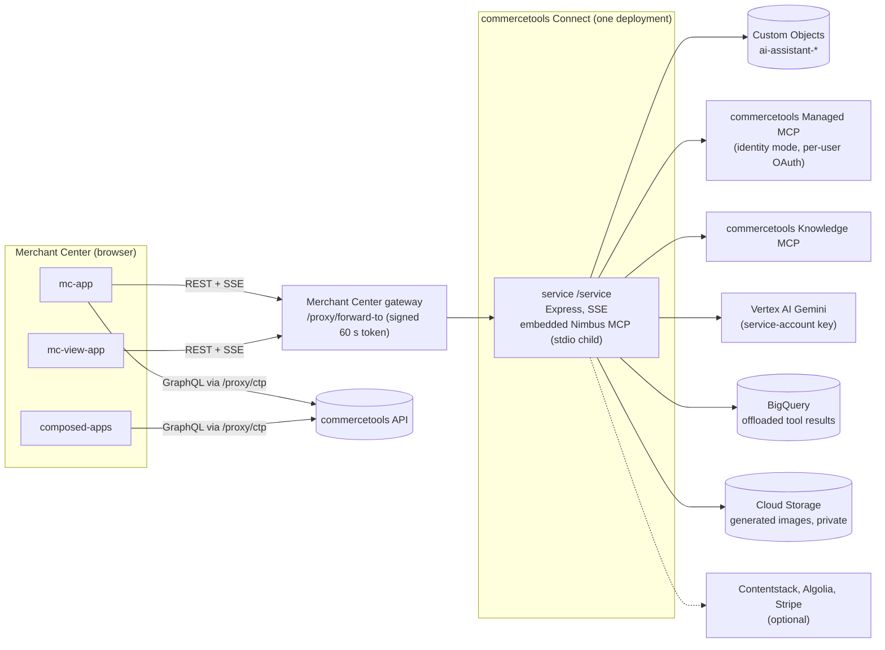
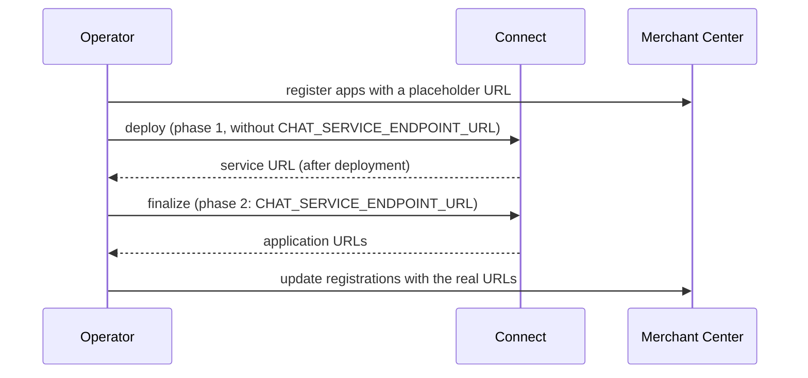

# Architecture

This document describes how the AI Assistant connector is built. Every section names the files it
is based on. For the mechanisms behind a chat turn see [how-it-works.md](./how-it-works.md); for the
operational view see [operations.md](./operations.md).

## Topology

One installation serves one commercetools project. It consists of one Connect `service` application and three Merchant Center
frontends, described by `connect.yaml`.



The service is mounted at `/service` (`service/src/app.ts`, `service/src/routes/service.route.ts`) and must equal the
`endpoint` of the `service` entry in `connect.yaml`. The browser reaches it only through the Merchant Center gateway
(`forward-to`), so the service has no CORS handling and no browser origin to allow.

## Applications

| Application | Type | Folder | Configuration it needs | Talks to the service |
| --- | --- | --- | --- | --- |
| `service` | `service`, endpoint `/service` | `service/` | see [configuration.md](./configuration.md) | - |
| `mc-app` | Custom Application "AI Assistant" | `mc-app/` | `CUSTOM_APPLICATION_ID`, `ENTRY_POINT_URI_PATH` | yes |
| `composed-apps` | Custom Application "AI Assistant Pages" | `composed-apps/` | `CUSTOM_APPLICATION_ID`, `ENTRY_POINT_URI_PATH` | no (a pure Merchant Center GraphQL client; `composed-apps/README.md`) |
| `mc-view-app` | Custom View, `CustomPanel`, 65 locators | `mc-view-app/` | `CUSTOM_VIEW_ID` | yes, with the query parameter `customView` |

`CLOUD_IDENTIFIER` and `CHAT_SERVICE_ENDPOINT_URL` are shared by all applications through `inheritAs.configuration` in `connect.yaml`, so each is set once per deployment, without an application prefix.

The three frontends use the same `@commercetools-frontend/*` version, kept in step by hand. They cannot share a
build, so a few small files are copies that must stay identical (for example `utils/forward-to.ts`
and the composed page renderer files). Package names are `ai-assistant-<suffix>` (`ai-assistant-service`, `ai-assistant-mc-app`, ...), and
every `package.json` is `private`.

## Data model

All durable state is stored as commercetools Custom Objects, reached only through `service/src/persistence/gateway/custom-object.gateway.ts`.
Container names come from `service/src/persistence/names.ts`.

| Container | Key | Contents |
| --- | --- | --- |
| `ai-assistant-settings` | `default` | System prompt, tool-call log level, the Managed MCP binding with its encrypted OAuth client |
| `ai-assistant-sessions` | session id | One record per chat session: owner user ID, title, summary, icon, follow-up prompts, switched-off tools, feature flags, BigQuery table references |
| `ai-assistant-messages-<sessionId>` | message id | One object per message (parts stored as a JSON string) |
| `ai-assistant-identity-tokens` | user ID | Per-user Managed MCP tokens, encrypted with AES-256-GCM |
| `ai-assistant-identity-auth-states` | SHA-256 of the OAuth state | One login attempt (encrypted PKCE verifier), valid for 10 minutes |
| `ai-assistant-feedback` | feedback id | Feedback record: comment, owner, transcript digest and the session settings at the time (system prompt copy, switched-off tools) |
| `ai-assistant-feedback-snap-<feedbackId>` | `<id>-<ordinal>` | Chunks of the transcript snapshot taken at feedback time (192 KiB chunks, at most 8 MiB) |
| `ai-assistant-suggestions` | user ID | Cached personalised prompt suggestions (safe to lose) |
| `shared-composed-pages` | page key | Composed pages written by `mc-app` with the user's own token and read by `composed-apps` |

Why one object per message: a Custom Object is limited in size, appends need no read-modify-write, and the session list stays small.
Writes use optimistic concurrency with the object version and retry on conflict (`service/src/persistence/gateway/cas.ts`). The size limits and
the query limits (500 results per page, offset 10,000, at most 10,000 readable messages per session) are in
`service/src/persistence/limits.ts`. Secrets are never stored in clear text: tokens, the PKCE verifier and the OAuth client secret are
envelopes produced by `service/src/crypto/envelope.ts`.

## Authentication flow

1. The app calls the service with `forwardToFetch` (`mc-app/src/utils/forward-to.ts`). The Merchant Center gateway signs a token
   that carries the user ID and the project key, and forwards the request.
2. `service/src/middleware/mc-session.middleware.ts` accepts only `Authorization: Bearer <token>` and verifies it with `createSessionAuthVerifier`
   (audience policy `forward-url-full-path`: the audience is the origin of `CONNECT_SERVICE_URL` plus the request path, issuer from the cloud identifier derived from `CTP_REGION`).
3. The project key in the token must equal `CTP_PROJECT_KEY` (`service/src/auth/project-guard.ts`), otherwise 403.
4. `isAdmin` is true only when the token's user ID is in `ADMIN_USER_IDS` (`service/src/auth/admin.ts`). The result is attached to `req.user`
   and returned by `POST /service/auth/session` together with `userId`; there is no e-mail address in the token and none is returned.
5. Ownership is by user ID: a session of another user answers 404 (`service/src/middleware/load-session.middleware.ts`). Administrators read other
   users' data only through the backoffice routes and the image route.

Until `CONNECT_SERVICE_URL` is available to the service it answers 401 to every authenticated route. The local development bypass (`MC_AUTH_DISABLED`) is refused when
`NODE_ENV` is `production`, which is also the default when it is unset (`service/src/config/sections/auth.ts`).

## Stateless design

Anything that must survive a request or be shared by two instances goes through the persistence layer. In-process memory is only a cache:
the tool-set cache (`MCP_TOOLS_TTL_MS`), the settings cache (`SETTINGS_CACHE_TTL_MS`), the identity tool-set cache and the JWKS cache of the verifier.
Correctness therefore holds with several instances and with scale to zero. A change to a setting can take up to `SETTINGS_CACHE_TTL_MS` (5 s by default) to be seen by
another running instance. The per-process state with a lifecycle is the embedded Nimbus child process (`service/src/nimbus/process-manager.ts`) and the replay buffer of running chat turns
(`service/src/chat/turn-buffer.ts`, see below). The replay buffer only lets a browser reattach to a turn; the stored answer does not depend on it.

## Request time budget

Connect ends a request after five minutes. The chat stream therefore has its own budget (`service/src/chat/request-budget.ts`):

```
request start                 soft deadline            hard deadline        Connect limit
|---- history, tools ready ----|-- running tools stop --|-- finish + notice --|   300 s
0                           240 s                    270 s
```

At the soft deadline (`CHAT_REQUEST_BUDGET_MS` minus `CHAT_FINALIZE_RESERVE_MS`) running tools are answered with a stop message and the model gets one
step to wrap up. At the hard deadline a notice and a stored `data-turn-status` part are appended and the stream ends normally. A transient
`data-keepalive` part is written every 20 s while the stream is idle. See `service/src/chat/stream.ts`.

### The browser's connection

The Merchant Center gateway (`/proxy/forward-to`) sits between the browser and the service, and a response through it has been observed to end after about 120 s (a `net::ERR_QUIC_PROTOCOL_ERROR` in the browser) while the
service does not notice: the turn runs to its own end and is stored. A long turn therefore finishes on the service although the browser lost the stream. The chat app (`mc-app`) handles it in three steps; the Custom View (`mc-view-app`) does not, and keeps its earlier behaviour (it shows the error):

1. The service copies every SSE frame of a running turn into a per-session buffer (`service/src/chat/turn-buffer.ts`: at most 8 MiB per turn, 256 turns and 96 MiB per process, the provider metadata of each frame is dropped, a finished turn is kept for 120 s and goes first when the budget is reached).
2. When the stream fails after the answer had started, `mc-app` calls the AI SDK's `resumeStream()`, which sends `GET .../message/stream?messageId=<answer>`. The service replays the turn from its first frame and follows it live (`service/src/chat/stream-resume.controller.ts`), but only the turn the id names, so a buffer of an earlier turn is never put under a newer answer. `mc-app` tries this up to three times, since each reattach can be cut too. A connection that does not read cannot make the service hold copies of the turn: a frame is written only after the connection took the previous ones.
3. When there is nothing to reattach to (204, a failed connect, or the attempts are used up) `mc-app` reads the stored messages every 4 s, up to 75 times, and puts the stored answer in place of the partial one. After that it shows an error that says the answer may still be there (`mc-app/src/components/new-chat/use-stream-recovery.ts`).

No step starts a second model run: while it recovers, `mc-app` offers no Try again and no new message. A failure before the answer had started, and an error the service reports itself, are handled as before: the error is shown. The stop button also calls `DELETE .../message/stream?messageId=<answer>`, because a reattached stream is not the request the run was started with. That stop is best effort: it reaches only a turn that runs on the instance that receives it, and the reply says `Nothing to stop` otherwise.

## Security boundaries

- Secrets live in `securedConfiguration` of `connect.yaml` only; the service reads them once in `service/src/config` and wraps them in `Secret` values that never print.
- Browser-supplied identity is never used: no source file reads an e-mail, label or admin flag from a request.
- Per-user data is filtered by the verified user ID in the service layer (`service/src/services/session.service.ts`), never by a value from the request body or query.
- Generated page code runs in the Merchant Center application's own origin (`mc-app/custom-application-config.mjs` allows `unsafe-eval` for it); the Custom View does not.
- Details: [security.md](./security.md) and [permissions.md](./permissions.md).

## Package names

Every package in the development tree is private and named `ai-assistant-<suffix>`. The published
repository carries the same packages under the scope `@commercetools-labs/`; the rename is applied when the
repository is published, so a clone of the published repository shows the third column.

| Folder | Development name | Published name |
| --- | --- | --- |
| `service/` | `ai-assistant-service` | `@commercetools-labs/ai-assistant-service` |
| `mc-app/` | `ai-assistant-mc-app` | `@commercetools-labs/ai-assistant-mc-app` |
| `composed-apps/` | `ai-assistant-composed-apps` | `@commercetools-labs/ai-assistant-composed-apps` |
| `mc-view-app/` | `ai-assistant-mc-view-app` | `@commercetools-labs/ai-assistant-mc-view-app` |
| `scripts/` | `ai-assistant-scripts` | `@commercetools-labs/ai-assistant-scripts` |
| `@types-extensions/json-stable-stringify/` in each frontend | `ai-assistant-types-json-stable-stringify` | `@commercetools-labs/ai-assistant-types-json-stable-stringify` |

## Dependencies

These are the external dependencies; [operations.md](./operations.md) has one row for each in its fail-open and fail-closed table.

| Dependency | Used by | Code |
| --- | --- | --- |
| Merchant Center gateway keys | token verification | `service/src/middleware/mc-session.middleware.ts` |
| `ADMIN_USER_IDS` configuration | administrator decision | `service/src/auth/admin.ts` |
| commercetools Custom Objects | all state | `service/src/persistence/` |
| Vertex AI (Gemini) | chat, digests, suggestions, images | `service/src/llm/models.ts` |
| Identity Managed MCP server | the user's commercetools tools | `service/src/identity-mcp/` |
| Knowledge MCP, Contentstack, Algolia, Stripe | optional tool sources | `service/src/tool-sources/` |
| Embedded Nimbus MCP | design-system documentation tools | `service/src/nimbus/` |
| BigQuery | offloaded tool results | `service/src/analytics/` |
| Cloud Storage | generated images | `service/src/storage/` |

## Deployment flow

The service URL exists only after the first deployment, so deployment has two phases (`scripts/connect/connect.mjs`):



The service takes the audience of the Merchant Center token from the origin of `CONNECT_SERVICE_URL` (no path, because the verifier appends the request path). That depends on Connect providing the variable to the running service; its documentation only names it for the lifecycle scripts, so this is an open item (U5 in the runbook). The lifecycle scripts
(`service/src/connector/post-deploy.ts`) verify the configuration and report problems, including the service origin they see; they do not register anything.
Commands are in [deployment-runbook.md](./deployment-runbook.md).

## Testing layers

| Layer | Tool | Where |
| --- | --- | --- |
| Service logic | Jest, supertest, msw, in-memory persistence | `service/tests/` |
| Service against Custom Objects, Google Cloud, MCP servers | integration suites, skipped without credentials | `service/tests/integration/` |
| Frontends | `tsc`, ESLint, Jest, `mc-scripts build` | each frontend folder |
| Deployment helper | Node test runner | `scripts/tests/` |
| Deployed connector | manual checks in a browser logged in to the Merchant Center | see [troubleshooting.md](./troubleshooting.md) |

## Decisions

- One credential, one deployment: a single Base64 service-account key serves Vertex AI, BigQuery and Cloud Storage (`service/src/gcp/service-account.ts`).
- No separate database: Custom Objects behind one gateway (`service/src/persistence/gateway/custom-object.gateway.ts`).
- The Nimbus MCP runs as a child process of the service because it only speaks stdio and Connect applications cannot reach each other (`service/src/nimbus/transport.ts`).
- Administrators are an allowlist of verified user IDs, not a Merchant Center permission (`service/src/auth/admin.ts`).
- Generated images stay in a private bucket and are streamed by the service; there are no signed URLs (`service/src/storage/files-route.ts`).
- The chat stream has its own time budget below Connect's five-minute limit (`service/src/chat/request-budget.ts`).
- Tool sources are plug-ins with isolated failure (`service/src/tool-sources/registry.ts`, `service/src/tool-sources/README.md`).
- Identity mode Managed MCP: every user acts with their own permissions; tokens are encrypted per user (`service/src/identity-mcp/auth-provider.ts`).
- Documentation platform references: https://docs.commercetools.com/connect/deployment-behavior-and-environments.md and https://docs.commercetools.com/api/projects/custom-objects.md
