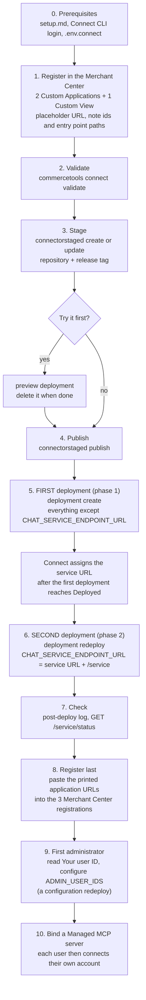

# Connect deployment

How the connector gets from your repository to a working installation, in which order, and why the deployment runs **twice**. The exact commands are in [deployment-runbook.md](./deployment-runbook.md); this page is the path. Everything uses the commercetools Connect command line, through the helper `scripts/connect/connect.mjs`. There are no GitHub Actions and no container or infrastructure code to maintain.

> **Deploy twice.** The Merchant Center applications (`mc-app` and `mc-view-app`) need the real `CHAT_SERVICE_ENDPOINT_URL`, the public URL of the service plus `/service`. That URL does not exist until Connect has deployed the service once. So the first deployment starts everything with a placeholder, and the second deployment (a redeploy of the same Deployment) passes the real value. `deploy` is the first run and `finalize` is the second.

## What gets deployed

One connector with four applications described by `connect.yaml`: the `service` and three Merchant Center applications (the chat application, the pages application and the Custom View). A deployment belongs to one commercetools project. Connect builds the applications from your repository at a tag, so it needs a repository it can read.

## The path

## Why twice

- The service knows its own public URL: it takes the audience of the Merchant Center token from `CONNECT_SERVICE_URL`. It needs no second step, provided Connect passes that variable to the running service (U5 in the runbook).
- The frontends cannot learn the URL by themselves. `CHAT_SERVICE_ENDPOINT_URL` is substituted into `custom-application-config.mjs` and `custom-view-config.mjs` when the applications are built, so it has to be known as a configuration value.
- The URL is assigned by Connect once the service is deployed, so it cannot be put into the first deployment. The first run therefore uses the default `https://not-configured.invalid/service`; the second run replaces it.
- `CHAT_SERVICE_ENDPOINT_URL` and `CLOUD_IDENTIFIER` are shared by all applications (`inheritAs.configuration` in `connect.yaml`). They are passed once, as a bare `KEY=value` item without an application prefix, while application keys use `application.KEY=value`.
- A redeploy is a partial merge: keys you do not pass keep their current value. The second run therefore sends only `CHAT_SERVICE_ENDPOINT_URL` and never re-sends a secret.

Open item: whether a configuration redeploy rebuilds the Merchant Center bundles with the new value is not confirmed yet (U2 in [the runbook](./deployment-runbook.md#11-verified-behaviour)). Check it after the second run: open the application and confirm that its requests go to your service and not to `not-configured.invalid`.

## Prerequisites

1. Everything in [setup.md](./setup.md): the Google Cloud project, the service-account key, the encryption key, the repository and tag, the local tools and any provider credentials.
2. A Connect API client with the scopes `manage_connectors`, `manage_connectors_deployments` and `manage_api_clients`, and the CLI logged in with it: `commercetools auth login --client-credentials --client-id <id> --client-secret <secret> --region <region> --project-key <key>`. The last scope lets Connect create the API client described by `inheritAs.apiClient` in `connect.yaml`.
3. `scripts/connect/.env.connect`, copied from `.env.connect.example` (git-ignored), holding the project key, region, repository, key values and the ids from step 1 of the path.
4. The Merchant Center registrations of step 1 (below).

## Order of operations

The order matters: the service URL does not exist until the first deployment, and the registrations need the final URLs.

| Step | What | Helper command | Connect CLI underneath |
| --- | --- | --- | --- |
| 1 | Register the two Custom Applications and the Custom View with a placeholder URL such as `https://placeholder.invalid`. Note each id and choose a unique entry point URI path for each application. The registered OAuth scopes must equal the ones in each application's configuration file ([README](../README.md#required-scopes)) | none (Merchant Center, Settings, Developer settings) | none |
| 2 | Validate `connect.yaml` and the applications | none | `commercetools connect validate` (needs Docker) |
| 3 | Stage the connector from your repository and tag | `connect.mjs stage` | `connectorstaged create`, or `update` when it exists |
| 3b | Optional: try the staged connector | `connect.mjs preview` | `connectorstaged preview`; delete it with `delete --preview --yes` |
| 4 | Publish. A sandbox or production deployment needs a published connector | `connect.mjs publish` | `connectorstaged publish` |
| 5 | First deployment (phase 1) | `connect.mjs deploy` | `deployment create --type sandbox --configuration ...` |
| 6 | Second deployment (phase 2) | `connect.mjs finalize` | waits for `Deployed`, then `deployment redeploy --configuration CHAT_SERVICE_ENDPOINT_URL=<origin>/service` |
| 7 | Check | part of `finalize` | `deployment logs`, then `GET <origin>/service/status` |
| 8 | Update the three registrations with the printed URLs | none | none |
| 9 | Read "Your user ID" under Settings, About, then set the allowlist ([permissions.md](./permissions.md#becoming-the-first-administrator)) | `connect.mjs configure ADMIN_USER_IDS=<id>` | `deployment redeploy` |
| 10 | Optional providers, one configuration redeploy per change | `connect.mjs configure KEY=VALUE` | `deployment redeploy` |
| 11 | An administrator creates a Managed MCP server in identity mode and binds it in the application; each user connects their own account | none | none |

Add `--dry-run` to any helper command to print what would run (secured values show as `***`) without running it.

### What each run sends

- **First run (`deploy`)**: the two secrets (`GCP_SA_KEY_BASE64`, `ENCRYPTION_KEY`), `CTP_REGION`, the registration ids and entry point paths of the three applications, `CLOUD_IDENTIFIER` (derived from the region, so the service and the frontends cannot disagree) and any optional settings. It does not wait; it prints the command with secrets masked.
- **Second run (`finalize`)**: waits up to about 25 minutes for the first deployment to reach `Deployed` and report a service URL, redeploys with `CHAT_SERVICE_ENDPOINT_URL`, waits again, reads the `post-deploy:` lines, retries the smoke check for cold starts and prints the application URLs under `next: paste these URLs into the Merchant Center registrations`.

## Check the result

- `curl <service origin>/service/status` answers 200 with `status` `UP` and `authConfigured` true.
- `node scripts/connect/connect.mjs logs` shows `post-deploy: OK`. A `post-deploy: FAILED <check>` line names the cause. The deployment status alone does not prove that the script succeeded, so read the log.
- The service log's `auth configuration` line shows `audience: <origin>`. `audience: not configured` means Connect did not provide `CONNECT_SERVICE_URL` to the running service (U5 in the runbook) and every authenticated request answers 401.

## Regions

Choose the Connect region of the deployment and the API region of your project with the same string (`us-central1.gcp`, `europe-west1.gcp`, `australia-southeast1.gcp`, `eu-central-1.aws` or `us-east-2.aws`), and deploy in the project's own region. The helper derives the Merchant Center cloud identifier (`gcp-us`, `gcp-eu`, `gcp-au`, `aws-eu`, `aws-us`) from it. The Vertex AI and BigQuery locations are separate settings ([setup.md](./setup.md#2-gemini-on-vertex-ai)).

## Deployment types

| Type | Use | Behaviour |
| --- | --- | --- |
| `sandbox` | First installs and testing (the default) | Needs a published connector; scales to zero, so the first request after a quiet period is slower (cold start) |
| `preview` | Trying a staged connector | Short lived; delete it when done |
| `production` | Live use | Needs a published connector and a non-trial project; the helper refuses it without `--confirm-production` |

A deployment can take up to about 15 minutes to reach `Deployed`. Connect ends a request after five minutes; the chat stream finishes its answer before that ([architecture.md](./architecture.md#request-time-budget)). The platform rules are in the [Connect documentation](https://docs.commercetools.com/connect/deployment-behavior-and-environments.md).

## Updating and rolling back

Tag the new code, then `connect.mjs update-code --tag <tag>`. It updates the staged connector, publishes it and redeploys with `--updateConnector`, because a plain redeploy keeps the current code. A rollback is the same command with the previous tag. If a new version fails to build, the previous code keeps serving; if the deployment's version number did not change, read the connector's publishing report.

A configuration change (`configure KEY=VALUE`) is a redeploy of the same Deployment, not a new one. Stored data (sessions, messages, settings, tokens, feedback) stays in Custom Objects across updates and across an undeploy: undeploying removes only the deployment's own probe object. To delete data on purpose, see [operations.md](./operations.md#data-retention).

## Undeploy

`connect.mjs delete --yes` deletes the deployment. Data in Custom Objects is kept (see above).

## Connect certification

The README at the repository root is the connector README that a certification review reads: configuration table, required scopes, fail-open and fail-closed behaviour, and the poison-message statement. `node scripts/docs/check-docs-claims.mjs --certify` checks that these are present. Certification itself is only needed to list a connector on the Connect marketplace; a private connector skips it.

## What is verified and what is not

The helper and the lifecycle checks are tested against fakes. Platform behaviours that need a real deployment (for example whether an empty optional key is absent or empty, whether a configuration redeploy rebuilds the frontends, and how long a deployment takes) are listed as open items in [section 11 of the runbook](./deployment-runbook.md#11-verified-behaviour) and are filled in by the first real deployment.
