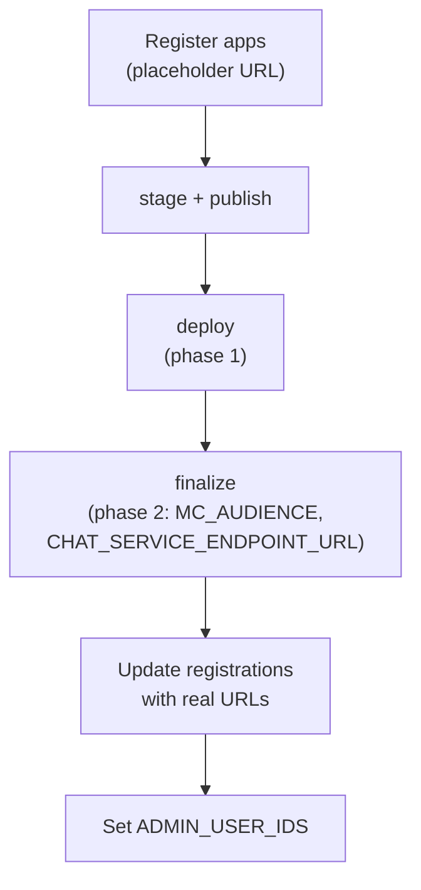

# Deployment guide

This page explains how the connector is deployed and in which order the steps happen. The exact commands are in
[deployment-runbook.md](./deployment-runbook.md); they are deliberately not repeated here. The deployment is done only with the commercetools Connect command line,
through the helper `scripts/connect/connect.mjs`. There are no GitHub Actions and no container or infrastructure code to maintain.

## What gets deployed

One connector with four applications described by `connect.yaml`: the `service` and three Merchant Center applications (the chat application, the pages application and the Custom View).
A deployment belongs to one commercetools project. Connect builds the applications from your repository at a tag, so you need a repository Connect can read.
For a private repository, grant the Connect staging user read access.

## Prerequisites

1. Tools: Node.js 22, the Connect CLI and a running Docker daemon (needed by `connect validate`).
2. A Connect API client with the scopes `manage_connectors`, `manage_connectors_deployments` and `manage_api_clients`, and the CLI logged in with it.
3. A Google Cloud project with a service-account key (roles in [configuration.md](./configuration.md#google-cloud)).
4. An `ENCRYPTION_KEY`: `openssl rand -base64 32`. Keep it; changing it later makes stored identity tokens unreadable.
5. The two Custom Applications and the Custom View registered in the Merchant Center ([the order below](#order-of-operations)).
6. Optional: provider credentials (Contentstack, Algolia, Stripe).

## Order of operations

The order matters, because the service URL does not exist until the first deployment and the Merchant Center registrations need the final URLs.

1. **Register first with a placeholder.** In the Merchant Center (Settings, Developer settings) register the Custom Application "AI Assistant", the Custom Application "AI Assistant Pages" and the Custom View "AI Assistant" with a placeholder URL.
   Note each id and choose a unique entry point URI path for each application. The OAuth scopes you register must match the ones in each application's configuration file ([README.md](../README.md#required-scopes)).
2. **Stage and publish** the connector from your repository tag. A sandbox deployment requires a published connector.
3. **Phase 1: deploy.** The deployment is created with the secrets, the registration ids, the region and any optional settings. The service starts but rejects every Merchant Center request, because `MC_AUDIENCE` is not yet known.
4. **Phase 2: finalize.** The helper reads the service URL, redeploys with `MC_AUDIENCE` (the service origin, no path) and `CHAT_SERVICE_ENDPOINT_URL` (origin plus `/service`) and checks `GET /service/status`. It prints the three application URLs.
5. **Register last with the real URLs.** Update the three registrations with the printed URLs.
6. **Bootstrap the first administrator.** Open the chat application, read the "Your user ID" line under Settings, About, and set `ADMIN_USER_IDS` with the helper's `configure` command ([permissions.md](./permissions.md#becoming-the-first-administrator)).
7. **Optional providers.** Set provider keys with `configure`; each change is a configuration redeploy.
8. **Bind a Managed MCP server.** An administrator creates a Managed MCP server in identity mode and binds it in the application; each user then connects their own account.

Why two phases: Connect gives the public service URL only to the lifecycle scripts, never to the running service, and the frontends read it at build time (whether a configuration redeploy rebuilds them is still an open item, see the end of this page). `MC_AUDIENCE` is the origin only because the token verifier appends the request path.

## Regions

Choose the Connect region of the deployment and the API region of your project with the same string (`us-central1.gcp`, `europe-west1.gcp`, `australia-southeast1.gcp`, `eu-central-1.aws` or `us-east-2.aws`).
The helper derives the Merchant Center cloud identifier (`gcp-us`, `gcp-eu`, `gcp-au`, `aws-eu`, `aws-us`) from it, so the service and the frontends cannot disagree. The Vertex AI and BigQuery locations are separate settings.

## Deployment types

| Type | Use | Behaviour |
| --- | --- | --- |
| `sandbox` | First installs and testing | Needs a published connector; scales to zero, so the first request after a quiet period is slower (cold start) |
| `preview` | Trying a staged connector | Short lived; delete it when done |
| `production` | Live use | Needs a published connector and a non-trial project; the helper refuses it without an explicit confirmation flag |

A deployment can take up to about 15 minutes to reach `Deployed`. Connect ends a request after five minutes; the chat stream finishes its answer before that ([architecture.md](./architecture.md#request-time-budget)).
See https://docs.commercetools.com/connect/deployment-behavior-and-environments.md for the platform rules.

## Updating and rolling back

An update tags the new code in your repository and redeploys the connector at that tag. A rollback is the same operation with the previous tag. If a new version fails to build the previous code keeps serving.
Stored data (sessions, messages, settings, tokens, feedback) stays in Custom Objects across updates and across an undeploy: undeploying removes only the deployment's own probe object. See [operations.md](./operations.md#data-retention) to delete data on purpose.

## Connect certification

The README at the repository root is the connector README that a certification review reads: configuration table, required scopes, fail-open and fail-closed behaviour, and the poison-message statement.
`node scripts/docs/check-docs-claims.mjs --certify` checks that these are present. The Merchant Center applications are not in a shared package because each application only compiles its own folder; the few copied files are guarded by `scripts/check-duplicates.mjs`.

## What is verified and what is not

The scripts and the lifecycle checks are tested against fakes. The platform behaviours that need a real deployment (for example whether an empty optional key is absent or empty, whether a configuration redeploy rebuilds the frontends and how long a deployment takes)
are listed as open items in section 11 of [deployment-runbook.md](./deployment-runbook.md) and are filled in by the first real deployment.
