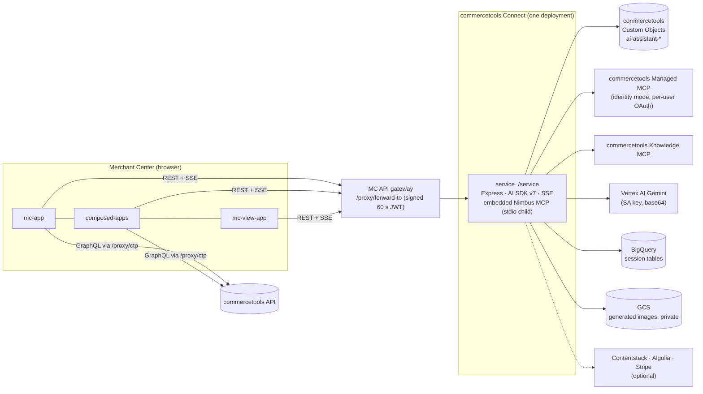

# 02 — Target architecture (single-tenant Connect connector)

## 1. Repository layout (Connect-conformant, per the `commercetools-connect` skill)

```
ai-assistant/                      # → github.com/commercetools/ai-assistant
├── connect.yaml                   # 3 deployAs entries (service, mc-app, composed-apps) + 1 view (mc-view-app) → see §2
├── service/                       # applicationType: service, endpoint: /service   (folder name == connect.yaml name)
│   ├── src/ (app.ts, index.ts, config/, middleware/, routes/, controllers/, services/,
│   │        persistence/, agents/…, nimbus/, connector/post-deploy.ts, pre-undeploy.ts)
│   ├── tests/  (jest "wire" + unit; msw/supertest)
│   └── package.json  (name: ai-assistant-service → @commercetools-labs/ai-assistant-service)
├── mc-app/                        # merchant-center-custom-application   (AI Assistant)
├── composed-apps/                 # merchant-center-custom-application   (AI Assistant Pages)
├── mc-view-app/                   # merchant-center-custom-view          (AI Assistant panel)
├── scripts/                       # deploy.sh wrappers around `commercetools connect …`, check-duplicates.mjs, e2e helpers
├── plans/  openspec/              # design documentation (published, scrubbed by spec X; changes archived by spec Z)
├── LICENSE  README.md  SUPPORT.md  CONTRIBUTING.md  .gitignore
└── (NO .github/workflows, NO Dockerfile, NO netlify.toml, NO terraform)
```

Rules from the skill that shape this: one folder per `deployAs` entry named exactly like `name`; shared code is a plain folder imported by relative path (the three frontends cannot share a build, so `forward-to.ts` is copied and guarded by a drift check); **no npm workspaces root**; Express router mounted at the same base as `endpoint`; `/status` health route; fail-fast env validation; `@commercetools/platform-sdk@^8` + `@commercetools/ts-client@^4`; least-privilege `inheritAs.apiClient.scopes`; secrets only in `securedConfiguration`; `commercetools connect validate` must pass.

## 2. `connect.yaml` (shape, finalised in spec B)

| Application | `applicationType` | Config keys (standard) | Config keys (secured) | Notes |
|---|---|---|---|---|
| `service` | `service`, `endpoint: /service` | `CTP_REGION` (standard config; Connect injects only `CTP_API_URL/AUTH_URL/CLIENT_ID/CLIENT_SECRET/PROJECT_KEY/SCOPE`), `MC_APP_ENTRY_POINT_URI_PATH`, `MC_AUDIENCE` (optional at boot, set by redeploy), `ADMIN_USER_IDS` (optional, comma-separated Merchant Center user ids = administrator allowlist; empty = nobody is admin), `CHAT_REQUEST_BUDGET_MS`, `CHAT_FINALIZE_RESERVE_MS`, `NIMBUS_MCP_ENABLED`, `GEMINI_AGENT_MODEL_NAME`, `GEMINI_IMAGE_MODEL_NAME`, `GEMINI_MODEL_NAME`, `GEMINI_LITE_MODEL_NAME`, and the Google Cloud settings (Q9, every one optional with a default): `GCP_PROJECT_ID` (default: the SA key's `project_id`), `GCP_VERTEX_LOCATION` (`us-central1`), `GCP_BIGQUERY_DATASET_ID` (`aiassistant`), `GCP_BIGQUERY_LOCATION` (`us-central1`), `GCP_BUCKET_NAME` (`<project>-ai-assistant-images`), `GCP_BUCKET_LOCATION` (`us-central1`), `IMAGE_URL_MODE` (`private` default, or `public`), `MCP_TOOLS_TTL_MS`, `LOG_LEVEL`, `CONTENTSTACK_BRANCH`, `CONTENTSTACK_REGION` (default `na`), `STRIPE_CONNECTED_ACCOUNT_ID` | `GCP_SA_KEY_BASE64`, `ENCRYPTION_KEY` (32-byte base64), and the optional third-party provider secrets `CONTENTSTACK_API_KEY`, `CONTENTSTACK_MANAGEMENT_TOKEN`, `ALGOLIA_MCP_URL` (may embed a key), `STRIPE_SECRET_KEY` | `inheritAs.apiClient.scopes: [view_key_value_documents, manage_key_value_documents]` (+ whatever spec E/I prove necessary). `scripts.postDeploy` verifies SA parse + Vertex reachability + custom-object write + the Google analytics self-check (creates the BigQuery dataset and the image bucket when missing and permitted, otherwise warns with the fix), idempotently, and reports which providers are configured (names only). A provider is enabled iff its required keys are set and valid (Contentstack: API key + management token; Algolia: URL; Stripe: secret key); partial sets warn at startup and disable it (owner decision Q4) |
| `mc-app` | `merchant-center-custom-application` | `CUSTOM_APPLICATION_ID`, `ENTRY_POINT_URI_PATH`, `CLOUD_IDENTIFIER`, `CHAT_SERVICE_ENDPOINT_URL` | — | no `endpoint`, no `securedConfiguration`, no `APPLICATION_URL` (Connect injects it) |
| `composed-apps` | `merchant-center-custom-application` | `CUSTOM_APPLICATION_ID`, `ENTRY_POINT_URI_PATH`, `CLOUD_IDENTIFIER` (no service dependency, spec R) | — | second Custom Application |
| `mc-view-app` | `merchant-center-custom-view` | `CUSTOM_VIEW_ID`, `CLOUD_IDENTIFIER`, `CHAT_SERVICE_ENDPOINT_URL` | — | `CustomPanel`, 65 locators |

> The Connect skill's wording: custom *views* use `CUSTOM_VIEW_ID` + `CLOUD_IDENTIFIER` and no entry-point path. Spec B verifies with `commercetools connect validate` and the `connect.yaml` docs (the `Knowledge MCP` doc search) before freezing.

## 3. Runtime topology



Differences vs. the multitenant system: no Firestore, no Pub/Sub, no Cloud Run, no second gateway service, one project, one Connect deployment, Gemini through Vertex AI.

## 4. Cross-cutting design rules (every spec must follow)

1. **Stateless service.** Anything that must survive a request or be shared by two instances goes through a persistence interface (spec E). In-memory = cache only.
2. **Fail closed** on auth (no `MC_AUDIENCE` ⇒ reject; `projectKey` mismatch ⇒ 403; empty `ADMIN_USER_IDS` ⇒ nobody is admin).
   **Admin model (owner decision 2026-10-09):** the service alone decides `isAdmin` = the verified forward-to JWT's user id (`sub`) is in `ADMIN_USER_IDS` (comma-separated; the platform passes a configuration value as one plain string). The JWT is signed by the MC gateway, so it cannot be forged; anything the browser sends (headers, body, query, e-mail, `userLabel`) is never used for authorization, keys or filters. No Merchant Center permission group exists: the apps only declare their default View/Manage pair, and `view_mcp_servers`/`manage_mcp_servers` are ordinary `oAuthScopes`. The frontends read `isAdmin` and `userId` from `POST /auth/session` only and show a read-only 'Your user ID' line so an administrator can find the id to add. Non-admins see no admin surfaces and get 403 `ADMIN_REQUIRED`; an empty list means nobody is admin (startup warning).
3. **Typed end to end** (`@commercetools/platform-sdk` types at boundaries, no `any` escapes, no dead code, no `console.log`; use `@commercetools-backend/loggers`).
4. **Config** is read once by `readConfiguration()` (spec C); modules never read `process.env` directly.
5. **Secrets** never in logs, responses, `standardConfiguration`, or Custom Objects unencrypted. Third-party provider credentials are Connect `securedConfiguration` only (never stored, never returned; the status endpoint reports names and booleans).
6. **5-minute request ceiling** (D13): the chat stream has a time budget (default 270 s) after which it finalises the turn gracefully.
7. **Every source file** carries the SPDX header (spec A tooling; spec X verifies).
8. **No tenant words** (`tenant`, `multitenant`, `projects/{key}`) remain in code or docs except in the historical changelog.
9. **Each spec ships its own tests** (Definition of Done in [04-workflow.md](./04-workflow.md)).
