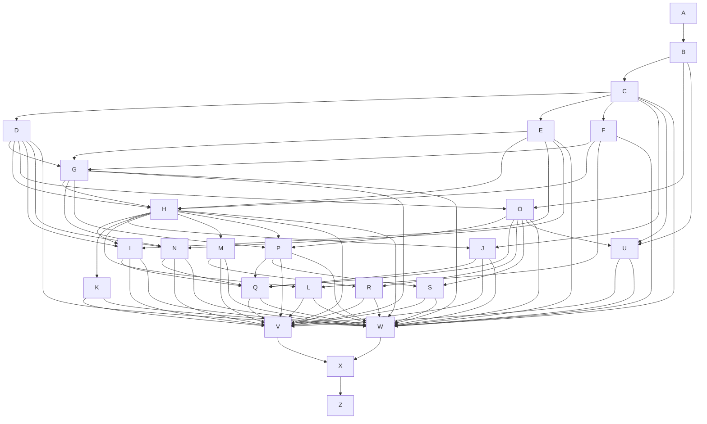

# 03 — Spec dependency map (A → Z)

One OpenSpec **change** per row. Change directory: `openspec/changes/<id>/` (artifacts: `proposal.md`, `design.md`, `specs/<capability>/spec.md`, `tasks.md`).
`Needs` = must be **implemented** (not just planned) first. Letters `T` and `Y` are intentionally unused (T was a withdrawn spec).

| ID | Change name | One-line scope | Needs | Wave | Size* |
|---|---|---|---|---|---|
| A | `a-repo-bootstrap-labs-compliance` | Repo skeleton, LICENSE/SUPPORT/CONTRIBUTING/README banner, `.gitignore`, SPDX tooling (`ossify`/`gate` wrappers, local only), `.env.example` rules | — | 0 | S |
| B | `b-connect-skeleton` | `connect.yaml`, app folders, config keys, scopes, `commercetools connect validate` green with stub apps | A | 1 | M |
| C | `c-service-foundation` | Copy service shell: Express app, config validation, logger, errors, request context, cache, health/status, startup audit; strip tenancy shell | B | 2 | M |
| D | `d-mc-session-auth` | forward-to JWT verification, single-project guard, `/auth/session`, `ADMIN_USER_IDS` admin check + `requireAdmin`, dev bypass guard | C | 3 | M |
| E | `e-persistence-custom-objects` | Repository interfaces + Custom Object & in-memory implementations, encryption, concurrency, settings object | C | 3 | L |
| F | `f-gcp-credentials-and-vertex-llm` | Base64 SA loader, Vertex Gemini providers, token counting, image model, remove API-key & unused providers | C | 3 | M |
| G | `g-chat-sessions-and-digest` | Session/message APIs, digest, suggestions, tool-menu prefs, system prompt & tool-call-log endpoints | D, E, F | 4 | L |
| H | `h-agents-and-chat-stream` | Agent registry, orchestrators, subagent tool, SSE endpoint, analyzer, prompts, tool-source registry, schema normalisation, time budget | D, E, F, G | 5 | XL |
| I | `i-identity-managed-mcp` | Identity-mode Managed MCP: OAuth+PKCE, token store, binding endpoints, tool set, commercetools agent wiring; binding endpoints admin-only (`ADMIN_USER_IDS`) | D, E, H | 6 | L |
| J | `j-third-party-tool-sources` | Knowledge MCP, Contentstack, Algolia, Stripe; provider keys from Connect configuration (validation + read-only `GET /mcp/providers`) | C, H | 6 | L |
| K | `k-nimbus-mcp-embedded` | In-process Nimbus MCP child manager + client, readiness | H | 6 | M |
| L | `l-bigquery-and-gcs` | Tool-result offload, `query_aggregated_data`, `get_table_info`, export, image upload, SQL guard | F, H | 6 | L |
| M | `m-composed-pages` | `create_composed_page` tool, v5.0 schema contract, page storage contract | H | 6 | M |
| N | `n-feedback-and-backoffice-api` | Feedback submit/fetch, chunked snapshots, backoffice threads/is-admin | D, E, G | 5 | M |
| O | `o-frontend-foundation` | Align 3 MC apps (versions, scripts, configs), `forward-to`, auth bootstrap (`isAdmin`, `userId`), default permissions only, duplicate-drift check, env contract | B, D | 4 | L |
| P | `p-mc-app-chat-surface` | mc-app chat, sessions drawer, composer, parts, tool menu, empty state, view switcher | O, G, H | 6 | XL |
| Q | `q-mc-app-admin-surfaces` | Identity-MCP connect page, configuration panel (read-only MCP provider status cards), backoffice, feedback UI | O, I, J, N, P | 7 | L |
| R | `r-composed-apps-app` | `composed-apps`: pages list + renderer, data sources | O, M | 7 | M |
| S | `s-mc-view-app` | `mc-view-app`: custom panel, locators, feature flags | O, P | 7 | M |
| U | `u-connect-deployment-no-gha` | `scripts/` around Connect CLI: stage/preview/publish/deploy, two-phase deploy, `postDeploy`/`preUndeploy` scripts, README runbook | B, C, E, F, O (+ J soft: provider report) | 7 | M |
| V | `v-e2e-chrome-testing` | Chrome-DevTools-driven E2E playbooks + fixtures per feature, evidence capture, regression checklist | U + all feature specs (G–S) | 8 | L |
| W | `w-docs-and-readmes` | README, architecture, how-it-works, FEATURES.md regenerate, runbooks, config reference | C–S, U | 9 | M |
| X | `x-labs-publication-gate` | `ossify` apply, headers, name scope, history strip, `gate.mjs` clean, anonymous-clone build proof | W, V | 10 | M |
| Z | `z-release-verification` | Final A→Z acceptance checklist, tag, Connect production readiness checklist, handover | X  | 11 | S |

*Size: S ≈ ½ day, M ≈ 1–2 days, L ≈ 3–5 days, XL ≈ 1–2 weeks for one developer.

## Dependency graph

## Build waves (what can run in parallel)

| Wave | Specs | Parallel? |
|---|---|---|
| 0 | A | — |
| 1 | B | — |
| 2 | C | — |
| 3 | D, E, F | yes (3 devs / 3 sessions) |
| 4 | G, O | yes |
| 5 | H, N | yes |
| 6 | I, J, K, L, M, P | yes |
| 7 | Q, R, S, U, | yes |
| 8 | V | — |
| 9 | W | — |
| 10 | X | — |
| 11 | Z | — |

## Critical path

A → B → C → E → G → H → I → Q → V → W → X → Z. Anything that slips on this chain slips the release; D/F/K/L/M/R/S have float.

## Interface contracts between specs (so parallel work does not collide)

| Contract | Defined by | Consumed by |
|---|---|---|
| `AppConfig` shape (`readConfiguration()`) | C | all backend specs |
| `RequestUser { userId, projectKey, isAdmin }`, `requireAdmin` middleware (admin = `ADMIN_USER_IDS` membership) | D | G, H, I, N |
| Bootstrap fields `userId` + `isAdmin` and the 'Your user ID' line (bootstrap hook in O, UI in P and S) | D (service), O (hook) | P, Q, S, V |
| Persistence interfaces (`SessionStore`, `MessageStore`, `SettingsStore`, `TokenStore`, `FeedbackStore`, `SuggestionStore`) | E | G, H, I, N |
| `AppConfig.providers` (`ProvidersConfig`, `ProviderStatus`; the seven provider keys) | C (validators completed by J) | J, Q (via `GET /mcp/providers`), U (postDeploy report) |
| `getModel('main'\|'lite'\|'image')`, `getGoogleCredentials()` | F | G, H, L |
| `ToolSource` registry (`name`, `isEnabled(ctx)`, `getTools(ctx)`, `listForMenu(ctx)`) | H | I, J, K, L, M |
| REST contract of the service (OpenAPI-lite table in `docs/api.md`) | G (+H,I,J,N) | P, Q, R, S, V |
| Frontend env contract (`CHAT_SERVICE_ENDPOINT_URL`, `CUSTOM_APPLICATION_ID`, …) | B/O | P, Q, R, S, U |
